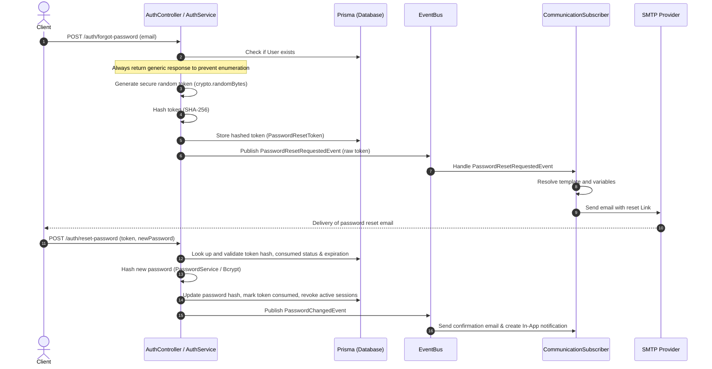

# Identity Recovery & Verification Workflow Architecture

This document describes the design, implementation, and security models of the Identity Recovery and Verification workflows in CampusFlow ERP.

---

## 1. High-Level Architecture & Sequence Diagrams

The Recovery and Verification workflows strictly follow the system's **Anti-Gravity Clean Architecture** principles: the `Auth` module publishes domain events to the unified `EventBus` rather than communicating directly with mail servers, templates, or SMS providers.

### Password Reset Flow (Token-based)



---

## 2. Security Model & Threat Analysis

### Zero-Raw Storage Principle
To prevent token leakage or account takeover in case of database compromise:
* **Reset Tokens**: Only the SHA-256 hash of the password reset token is stored in the database.
* **OTP Tokens**: The database stores only the SHA-256 hash of the generated OTP.
* **Passwords**: Passwords are saved only as bcrypt/Argon2 hashes. Old passwords are never saved.

### Threat Model & Mitigation Matrix

| Threat Vector | Risk Level | Mitigation Mechanism |
| :--- | :--- | :--- |
| **Email Enumeration** | Low | `/auth/forgot-password` always returns a generic success response regardless of user existence. |
| **Token Replay / Hijacking** | High | Reset tokens are single-use (`isConsumed: true` upon first use) and expire in 15 minutes. |
| **OTP Brute-Force** | High | Maximum OTP attempts is set to 5. Upon reaching the limit, the token is permanently revoked. |
| **OTP Flooding / Gateway Exhaustion** | High | Cooldown period of 60 seconds is enforced before a new OTP can be requested for the same recipient & purpose. |
| **Log Leakage** | Critical | Raw passwords, OTPs, or reset tokens are never printed in logs or mapped to the audit payload. |
| **Unauthorized Session Hijacking** | High | Resetting a password invalidates all refresh tokens and terminates all active sessions, requiring a fresh login. |

---

## 3. Token & OTP Lifecycle State Machines

### Reset Token Lifecycle
```
[Generated] ---> (Hashed & Stored) ---> [Active (Valid for 15m)]
                                             |
                   +-------------------------+-------------------------+
                   |                                                   |
                   v                                                   v
        [Consumed (used to reset)]                             [Expired / Revoked]
```

### OTP Lifecycle
```
[Generated] ---> (Hashed & Stored) ---> [Active (Valid for 10m)]
                                             |
                   +-------------------------+-------------------------+
                   |                                                   |
                   v                                                   v
          [Used / Verified]                               [Attempts >= 5 / Expired]
```

---

## 4. Domain Event Flow

All recovered actions publish events to the core `EventBus`.

| Event Class | Event Name | Agg. Type | Trigger | Subscriber Actions |
| :--- | :--- | :--- | :--- | :--- |
| `PasswordResetRequestedEvent` | `communication.password_reset_requested` | `User` | Forgot password call | Resolves `PASSWORD_RESET` template, sends email. |
| `PasswordChangedEvent` | `communication.password_changed` | `User` | Reset password completes | Resolves `PASSWORD_CHANGED` template, sends confirmation, creates In-App notification. |
| `EmailVerificationRequestedEvent` | `communication.email_verification_requested` | `User` | Verification resend request | Resolves `EMAIL_VERIFICATION` template, sends OTP. |
| `EmailVerifiedEvent` | `auth.email_verified` | `User` | Email verified successfully | Triggers core flows, logs status. |
| `OtpSentEvent` | `communication.otp_sent` | `User` | Generic OTP sent | Resolves `OTP_VERIFICATION` template, sends OTP. |
| `OtpResendRequestedEvent` | `communication.otp_resend_requested` | `User` | Generic OTP resent | Resolves `OTP_VERIFICATION` template, sends OTP. |
| `OtpVerifiedEvent` | `communication.otp_verified` | `User` | OTP verified successfully | Logs status, finishes audit trail. |

---

## 5. Audit Logging Trail

The Audit Infrastructure intercepts these domain events and logs them automatically. No sensitive data is logged.

* **Audited Actions**: `CREATE` (token request), `UPDATE` (password change, status update), `EXECUTE` (OTP verification).
* **Logged Fields**: `userId`, `userEmail`, `timestamp`, `action`, `module`, `requestId`, `ipAddress`, `userAgent`.
* **Sanitized Fields**: Event body email HTML, raw tokens, and OTP codes are strictly suppressed.

---

## 6. API References & Examples

### Forgot Password (`POST /auth/forgot-password`)
* **Request**:
  ```json
  {
    "email": "student@campusflow.edu"
  }
  ```
* **Response (Generic)**:
  ```json
  {
    "message": "If the email matches an account in our system, a password reset link will be sent shortly."
  }
  ```

### Reset Password (`POST /auth/reset-password`)
* **Request**:
  ```json
  {
    "token": "a4b2c9d8...",
    "password": "NewSecurePassword123!"
  }
  ```
* **Response**:
  ```json
  {
    "message": "Password reset successfully"
  }
  ```

---

## 7. Extension Points

### Future MFA Integration
The OTP service already supports `OtpPurpose.MFA`. To implement Multi-Factor Authentication:
1. In the login flow, if a user has `isTwoFactorEnabled: true`, issue a temporary "mfa-required" token instead of full JWT/Refresh tokens.
2. Direct the user to a verify-otp endpoint: `/auth/verify-otp` with purpose `MFA`.
3. Upon success, issue the final Access & Refresh tokens.

### Future Passwordless Authentication
To implement passwordless login (Magic Links or OTP):
1. User enters identifier.
2. Generate OTP with purpose `LOGIN` and call `OtpSentEvent`.
3. User enters OTP.
4. Verify OTP using `verifyOtp`.
5. Upon successful verification, immediately issue Access and Refresh tokens.

---

## 8. Operational Considerations

* **Database Indexes**: Queries on `PasswordResetToken` and `OtpToken` are backed by compound indexes on `[identifier, purpose, isUsed, isRevoked]` and `[tokenHash]` to guarantee sub-millisecond lookups.
* **Token Pruning**: A recurring background cleanup task should periodically delete expired or consumed tokens to optimize table sizes.
