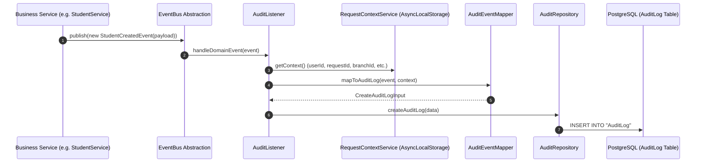

# Reusable Audit Infrastructure

CampusFlow ERP incorporates an enterprise-grade, decoupled **Audit Infrastructure**. It adheres strictly to Anti-Gravity clean architecture principles: business modules publish domain events using the existing `EventBus` without any awareness of audit logging. Audit operates purely as an infrastructure subscriber.

---

## Architecture & Sequence Diagram



### Core Architectural Principles

1. **Zero Business Coupling**: Business modules NEVER call `auditService.log(...)` or import `AuditModule`. Business modules only publish `DomainEvent` instances. Audit depends on `EventBus`.
2. **Context Enrichment**: `DomainEvent` represents **WHAT** happened (`eventId`, `eventName`, `occurredAt`, `aggregateId`, `aggregateType`, `version`, `metadata`). Context information (**WHO** performed it: `userId`, `requestId`, `role`, `organizationId`, `branchId`, `academicYearId`, `ipAddress`) is supplied by `RequestContextService` using Node's `AsyncLocalStorage`.
3. **Historical Data Integrity**: The `AuditLog` table does **NOT** enforce foreign key constraints on business tables (`User`, `Branch`, `Organization`). Audit history survives deletion of business entities.
4. **Field-Level Diff Support**: `AuditLog` supports field-level diffs (`changes` JSONB field containing array of `{ field, oldValue, newValue }`).
5. **No Live Credentials**: `AuditEventMapper` replaces credential-bearing payload keys (`rawOtp`, `otp`, `resetToken`, `token`, `refreshToken`, `accessToken`, `password`, `passwordHash`, `twoFactorSecret`) with `[REDACTED]` at any depth before a row is written. Recovery events carry the raw reset token and OTP to the communication subscriber; the audit copy must not.

---

## Database Design (`AuditLog` Model)

| Column Name | Type | Description |
| :--- | :--- | :--- |
| `id` | `String (UUID v7)` | Primary key generated via `@default(uuid(7))`. |
| `timestamp` | `DateTime` | Timestamp when event occurred. Indexed. |
| `eventName` | `String` | Original domain event string (e.g. `student.created`). |
| `action` | `String` | Action category (`CREATE`, `UPDATE`, `DELETE`, `LOGIN`, `EXECUTE`). Indexed. |
| `module` | `String` | Functional module (`ADMISSIONS`, `ORGANIZATION`, `AUTH`, `ACADEMIC`). Indexed. |
| `aggregateType` | `String` | Target entity name (e.g. `Student`, `Branch`). Indexed with `aggregateId`. |
| `aggregateId` | `String` | Primary ID of target entity. Indexed. |
| `userId` | `String?` | ID of user who initiated request. Indexed. |
| `userEmail` | `String?` | Email of user. |
| `role` | `String?` | Role of user (`SUPER_ADMIN`, `ORG_ADMIN`, `BRANCH_ADMIN`). |
| `organizationId` | `String?` | Organization UUID context. Indexed. |
| `branchId` | `String?` | Branch UUID context. Indexed. |
| `academicYearId` | `String?` | Academic Year UUID context. Indexed. |
| `requestId` | `String?` | Request correlation ID. Indexed. Matches the `requestId` of the response envelope. |
| `traceId` | `String?` | Distributed trace ID, when one was supplied. |
| `correlationId` | `String?` | Cross-request correlation ID, when one was supplied. |
| `ipAddress` | `String?` | Incoming client IP address. |
| `userAgent` | `String?` | Incoming client HTTP User Agent. |
| `httpMethod` | `String?` | HTTP method of the originating request. |
| `route` | `String?` | Route of the originating request. |
| `executionTime` | `Int?` | Handler duration in milliseconds. |
| `severity` | `String` | `INFO` (default), `WARN`, `ERROR`, `CRITICAL`. |
| `status` | `String` | `SUCCESS` (default), `FAILURE`. |
| `metadata` | `Json?` | Full event payload and custom attributes. |
| `changes` | `Json?` | Field-level diffs (`[{ field, oldValue, newValue }]`). |

Every column above is returned by the query API. `metadata` and `changes` are
the two exceptions: they are omitted from list results unless the request sets
`includeDetails=true`, and are always present on `GET /v1/audit-logs/:id`.

`severity` and `status` are plain string columns rather than database enums, so
the filter accepts any value; the four and two listed above are what the
pipeline writes.

---

## Integrated Modules & Event Map

The following ERP modules publish domain events that are automatically captured by `AuditListener` and persisted into `AuditLog`:

| Module | Published Domain Events | Inferred Audit Action | Inferred Audit Module |
| :--- | :--- | :--- | :--- |
| **Organization** | `organization.created`, `organization.updated`, `organization.deleted` | `CREATE`, `UPDATE`, `DELETE` | `ORGANIZATION` |
| **Branch** | `branch.created`, `branch.updated`, `branch.deleted` | `CREATE`, `UPDATE`, `DELETE` | `ORGANIZATION` |
| **Academic Year** | `academic_year.created`, `academic_year.updated`, `academic_year.deleted` | `CREATE`, `UPDATE`, `DELETE` | `ACADEMIC` |
| **Academic Unit** | `academic_unit.created`, `academic_unit.updated`, `academic_unit.deleted` | `CREATE`, `UPDATE`, `DELETE` | `ACADEMIC` |
| **Program** | `program.created`, `program.updated`, `program.deleted` | `CREATE`, `UPDATE`, `DELETE` | `ACADEMIC` |
| **User** | `user.created`, `user.updated`, `user.deleted` | `CREATE`, `UPDATE`, `DELETE` | `AUTH` |
| **Auth** | `user.logged_in` | `LOGIN` | `AUTH` |
| **System Settings** | `system_settings.updated` | `UPDATE` | `SYSTEM` |
| **Admissions** | `student.created`, `student.updated`, `student.deleted`, `applicant.created`, `applicant.updated`, `applicant.deleted`, `guardian.created`, `guardian.updated`, `guardian.mapped`, `guardian.unmapped`, `admission.transitioned`, `enrollment.completed`, `numbering_config.created`, `admissions_master.created`, `admissions_master.updated`, `admissions_master.deleted` | `CREATE`, `UPDATE`, `DELETE`, `EXECUTE` | `ADMISSIONS` |
| **Authorization** | `role_permissions.updated`, `user_permission_override.updated`, `user_permission_override.deleted`, `authorization.permission_denied` | `UPDATE`, `DELETE`, `EXECUTE` | `AUTHORIZATION` |
| **Workspace** | `workspace.module_created`, `workspace.module_updated`, `workspace.menu_created`, `workspace.menu_updated`, `workspace.menu_deleted`, `workspace.config_updated` | `CREATE`, `UPDATE`, `DELETE` | `WORKSPACE` |

### State transitions are audited as `.updated`

Every write leaves a trail, including the ones that are not a field edit — but
they share the generic event name of the entity they change, so the trail
records **that** the record changed and not **which transition** did it:

| Transition                                  | Event published          |
| :------------------------------------------ | :----------------------- |
| `PATCH /academic-years/:id/activate`        | `academic_year.updated`  |
| `PATCH /academic-years/:id/select`          | `academic_year.updated`  |
| `PATCH /academic-years/:id/lock`            | `academic_year.updated`  |
| `PATCH /academic-units/:id/move`            | `academic_unit.updated`  |
| `PATCH /academic-units/:id/status`          | `academic_unit.updated`  |
| `PATCH /programs/:id/status`                | `program.updated`        |
| `PATCH /branches/:id/status`                | `branch.updated`         |

So a client filtering on `eventName` cannot separate "this year was locked"
from "this year was renamed". Distinguishing them means either reading
`changes`, where the emitter reports one, or introducing dedicated event names
— which would be a new vocabulary, not a documentation change.

---

## Architectural Constraints for Future ERP Modules

> [!IMPORTANT]
> **Mandatory Auditing Rules for All Current and Future ERP Modules**:
>
> 1. **Centralized Domain Event Storage (`src/common/events/`)**:
>    ALL domain events across CampusFlow ERP MUST be defined inside `src/common/events/` (e.g. `src/common/events/hostel.events.ts`, `src/common/events/finance.events.ts`) and exported via `src/common/events/index.ts`. Creating `events/` subdirectories inside feature module folders (e.g. `src/modules/hostel/events/`) is strictly prohibited.
>
> 2. **Explicit Event Registration in `AuditListener`**:
>    Every new domain event name MUST be registered in the `registeredEventNames` set within `src/infrastructure/audit/audit.listener.ts`. Unregistered domain events will bypass the Audit Platform.
>
> 3. **Strict Decoupling (Event-Driven Auditing)**:
>    Business services must **NEVER** import or inject `AuditService` or `AuditRepository` directly. Services MUST ONLY publish domain events via `EventBus.publish(new DomainEvent(...))`.
>
> 4. **AuditEventMapper Compatibility**:
>    Domain events must either follow standard naming conventions (`module.action`, e.g., `hostel_room.created`) or explicitly provide `metadata.action` and `metadata.module` so `AuditEventMapper` correctly infers audit fields.
>
> 5. **Request Context Enriched**:
>    `AuditEventMapper` relies on `RequestContextService` (`AsyncLocalStorage`). Domain events must include `performedBy` / `userId` or execution context in payload/metadata for background asynchronous tasks.

---

## Developer Guide

### How New Business Modules Automatically Participate in Auditing

Business services publish domain events using `EventBus`:

```typescript
@Injectable()
export class AcademicYearService {
  constructor(
    private readonly prisma: PrismaService,
    private readonly eventBus: EventBus,
  ) {}

  async createAcademicYear(dto: CreateAcademicYearDto) {
    const year = await this.prisma.academicYear.create({ data: dto });

    // Business module only publishes the domain event!
    await this.eventBus.publish(
      new AcademicYearCreatedEvent({
        academicYearId: year.id,
        name: year.name,
        branchId: year.branchId,
      }),
    );

    return year;
  }
}
```

No calls to `AuditService` or `AuditRepository` are made inside business services. `AuditListener` automatically captures registered events, enriches them with `RequestContextService` (`AsyncLocalStorage`), and persists the audit log.

---

## Extending Event Mappings & Custom Subscribers

`AuditEventMapper` automatically infers `action` (`CREATE`, `UPDATE`, `DELETE`, `LOGIN`, `EXECUTE`) and `module` (`ADMISSIONS`, `AUTHORIZATION`, `WORKSPACE`, `ORGANIZATION`, `AUTH`, `ACADEMIC`, `SYSTEM`) from event names and aggregate types.

Custom event overrides can be specified in event metadata:

```typescript
const event = new BranchCreatedEvent(
  { branchId: 'b-100', name: 'West Campus', code: 'WC-01' },
  {
    action: 'UPDATE',
    module: 'ORGANIZATION',
    changes: [
      { field: 'name', oldValue: 'Old Name', newValue: 'West Campus' },
    ],
  },
);
```

---

## Future Queue Transport Integration (BullMQ / Kafka)

If `EventBus` is upgraded to `BullMQ` or `Kafka` in `EventsModule`, `AuditListener` continues to operate unchanged as a consumer. Audit remains completely decoupled from transport infrastructure.

---

## Audit Log Query API

CampusFlow ERP provides an enterprise-grade, secure **Audit Log Query API** to allow authorized users to query, analyze, and display audit trails.

### Authentication & RBAC Isolation

All query endpoints are protected under `JwtAuthGuard` and `RolesGuard`. The API strictly prevents horizontal privilege escalation by enforcing search boundaries automatically derived from the active `RequestContext`/`user` context:

| User Role | Access Boundaries | enforce Scoping |
| :--- | :--- | :--- |
| `SUPER_ADMIN` | Global Access | None. Can search across all organizations, branches, and users. |
| `ORG_ADMIN` | Organization Boundary | Restricted strictly to logs matching their own `organizationId`. Without an assigned organization, falls back to self-access. |
| `BRANCH_ADMIN` | Branch Boundary | Restricted strictly to logs matching their own `branchId`. Without an assigned branch, falls back to self-access. |
| `STAFF` | Self-Access | Restricted strictly to logs matching their own `userId`. |
| `STUDENT` | Self-Access | Restricted strictly to logs matching their own `userId`. |
| `PARENT` | Self-Access | Restricted strictly to logs matching their own `userId`. |

### Endpoints

All endpoints are mounted under `GET /v1/audit-logs`.

#### 1. Paginated Filter List
`GET /v1/audit-logs`

Allows querying paginated, filtered audit logs. To optimize performance and database payload sizes, the large JSON columns (`metadata` and `changes`) are excluded from the result list by default unless `includeDetails=true` is explicitly requested.

* **Pagination Params**:
  - `page` (number, default: `1`)
  - `limit` (number, default: `50`, max: `100`)
* **Sorting Params**:
  - `sortBy` (enum: `timestamp`, `severity`, `module`, `executionTime`, default: `timestamp`)
  - `sortOrder` (enum: `asc`, `desc`, default: `desc`)
* **Enterprise Filters**:
  - `userId`, `role`, `module`, `aggregateType`, `aggregateId`, `action`, `severity`, `status`, `organizationId`, `branchId`, `academicYearId`, `requestId`, `traceId`, `correlationId`, `httpMethod`, `route`
  - `startDate`, `endDate` (ISO Date Strings)
  - `minExecutionTime`, `maxExecutionTime` (number in ms)
* **Keyword Search**:
  - `search` (searches case-insensitively across `eventName`, `module`, `aggregateType`, `userEmail`, and `aggregateId`).
* **Details Toggle**:
  - `includeDetails` (boolean, default: `false`).

**`severity` and `status` vocabularies.** Both are filterable and both are
plain string columns, so the filter accepts anything. The values the audit
pipeline actually writes are:

- `severity` — `INFO` (default), `WARN`, `ERROR`, `CRITICAL`
- `status` — `SUCCESS` (default), `FAILURE`

**An unrecognised `sortBy` is ignored**, not rejected: the repository falls back
to `timestamp`. So `sortBy=createdAt` returns `200` sorted by `timestamp` — it
does not fail, and it does not sort by anything called `createdAt`.

##### Response shape

**Pagination is nested inside `data`, not on the envelope's `meta`.** The
handler wraps the service result, so the envelope's own `meta` stays `{}`:

```json
{
  "success": true,
  "message": "Audit logs retrieved successfully",
  "data": {
    "items": [ /* AuditLog[] — metadata and changes only when includeDetails */ ],
    "meta": { "total": 1204, "page": 1, "limit": 50, "totalPages": 25 }
  },
  "meta": {},
  "error": null,
  "requestId": "019fc2a1-0d7c-76cd-86ec-cbdf1628a566",
  "timestamp": "2026-08-05T09:12:44.310Z"
}
```

The keys are `total`, `page`, `limit`, `totalPages` — **`limit`, not
`pageSize`**, and the object is at `data.meta`, not `meta.pagination`.

#### 2. Detailed Summary API
`GET /v1/audit-logs/summary`

Returns total counts and distribution metrics (grouped by `module`, `action`, `severity`, and `status`) within the user's authorization boundary. This endpoint accepts the same filters as the paginated list.

Each of the four breakdowns is an array of `{ <dimension>, count }`, and each
sums to `totalCount` because all four group the same filtered set:

```json
{
  "success": true,
  "message": "Audit summary retrieved successfully",
  "data": {
    "totalCount": 1204,
    "byModule": [{ "module": "admissions", "count": 412 }],
    "byAction": [{ "action": "CREATE", "count": 180 }],
    "bySeverity": [{ "severity": "INFO", "count": 1180 }],
    "byStatus": [{ "status": "SUCCESS", "count": 1174 }]
  },
  "meta": {},
  "error": null,
  "requestId": "019fc2a1-0d7c-76cd-86ec-cbdf1628a566",
  "timestamp": "2026-08-05T09:12:44.310Z"
}
```

This endpoint is **not paginated** — the arrays hold one entry per distinct
value in the filtered set.

#### 3. Activity Timeline API
`GET /v1/audit-logs/timeline`

Returns daily log activity counts (within the specified or derived date ranges) to populate chronological analytics charts, plus the list of recent simplified chronological timeline events.

`dailyActivity` covers the **whole** filtered range. `events` is **one page** of
it, newest first, obeying `page` and `limit` — so the two are not two views of
the same rows, and summing `dailyActivity[].count` will not equal
`events.length`:

```json
{
  "success": true,
  "message": "Audit timeline retrieved successfully",
  "data": {
    "dailyActivity": [
      { "date": "2026-08-03", "count": 64 },
      { "date": "2026-08-04", "count": 87 }
    ],
    "events": [
      {
        "id": "018f3a5b-7c9d-7e8f-9a0b-1c2d3e4f5c00",
        "timestamp": "2026-08-04T11:02:19.441Z",
        "eventName": "ApplicantCreated",
        "action": "CREATE",
        "module": "admissions",
        "aggregateType": "Applicant",
        "aggregateId": "018f3a5b-7c9d-7e8f-9a0b-1c2d3e4f5ab0",
        "userEmail": "asha.verma@example.edu",
        "severity": "INFO",
        "status": "SUCCESS"
      }
    ]
  },
  "meta": {},
  "error": null,
  "requestId": "019fc2a1-0d7c-76cd-86ec-cbdf1628a566",
  "timestamp": "2026-08-05T09:12:44.310Z"
}
```

`date` is a `YYYY-MM-DD` calendar day in **UTC**. A timeline event carries ten
fields — it is a deliberately narrow projection of `AuditLog`, not the whole
record.

#### 4. Detail Lookup By ID
`GET /v1/audit-logs/:id`

Retrieves the full detailed record of a specific audit log by its ID (including `metadata` and `changes` fields). It strictly validates the user's role boundary and returns `403 Forbidden` if a user attempts to access logs outside their permitted scope.


