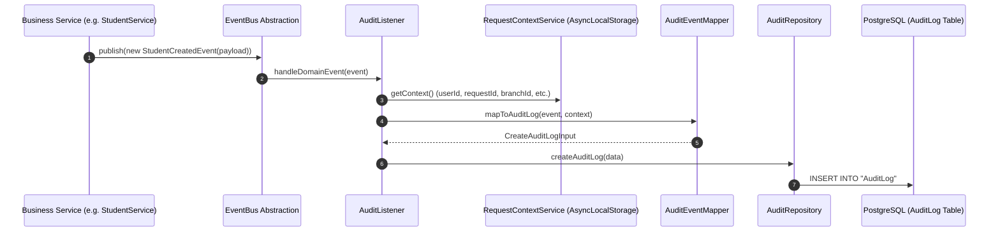

# Reusable Audit Infrastructure

CampusFlow ERP incorporates an enterprise-grade, decoupled **Audit Infrastructure**. It adheres strictly to Anti-Gravity clean architecture principles: business modules publish domain events using the existing `EventBus` without any awareness of audit logging. Audit operates purely as an infrastructure subscriber.

---

## Architecture & Sequence Diagram



### Core Architectural Principles

1. **Zero Business Coupling**: Business modules NEVER call `auditService.log(...)` or import `AuditModule`. Business modules only publish `DomainEvent` instances. Audit depends on `EventBus`.
2. **Context Enrichment**: `DomainEvent` represents **WHAT** happened (`eventId`, `eventName`, `occurredAt`, `aggregateId`, `aggregateType`, `version`, `metadata`). Context information (**WHO** performed it: `userId`, `requestId`, `role`, `organizationId`, `branchId`, `academicYearId`, `ipAddress`) is supplied by `RequestContextService` using Node's `AsyncLocalStorage`.
3. **Historical Data Integrity**: The `AuditLog` table does **NOT** enforce foreign key constraints on business tables (`User`, `Branch`, `Organization`). Audit history survives deletion of business entities.
4. **Field-Level Diff Support**: `AuditLog` supports field-level diffs (`changes` JSONB field containing array of `{ field, oldValue, newValue }`).

---

## Database Design (`AuditLog` Model)

| Column Name | Type | Description |
| :--- | :--- | :--- |
| `id` | `String (UUID v7)` | Primary key generated via `@default(uuid(7))`. |
| `timestamp` | `DateTime` | Timestamp when event occurred. Indexed. |
| `eventName` | `String` | Original domain event string (e.g. `student.created`). |
| `action` | `String` | Action category (`CREATE`, `UPDATE`, `DELETE`, `LOGIN`, `EXECUTE`). Indexed. |
| `module` | `String` | Functional module (`ADMISSIONS`, `ORGANIZATION`, `AUTH`, `ACADEMIC`). Indexed. |
| `aggregateType` | `String` | Target entity name (e.g. `Student`, `Branch`). Indexed with `aggregateId`. |
| `aggregateId` | `String` | Primary ID of target entity. Indexed. |
| `userId` | `String?` | ID of user who initiated request. Indexed. |
| `userEmail` | `String?` | Email of user. |
| `role` | `String?` | Role of user (`SUPER_ADMIN`, `ORG_ADMIN`, `BRANCH_ADMIN`). |
| `organizationId` | `String?` | Organization UUID context. Indexed. |
| `branchId` | `String?` | Branch UUID context. Indexed. |
| `academicYearId` | `String?` | Academic Year UUID context. Indexed. |
| `requestId` | `String?` | Request correlation ID. Indexed. |
| `ipAddress` | `String?` | Incoming client IP address. |
| `userAgent` | `String?` | Incoming client HTTP User Agent. |
| `metadata` | `Json?` | Full event payload and custom attributes. |
| `changes` | `Json?` | Field-level diffs (`[{ field, oldValue, newValue }]`). |

---

## Integrated Modules & Event Map

The following ERP modules publish domain events that are automatically captured by `AuditListener` and persisted into `AuditLog`:

| Module | Published Domain Events | Inferred Audit Action | Inferred Audit Module |
| :--- | :--- | :--- | :--- |
| **Organization** | `organization.created`, `organization.updated`, `organization.deleted` | `CREATE`, `UPDATE`, `DELETE` | `ORGANIZATION` |
| **Branch** | `branch.created`, `branch.updated`, `branch.deleted` | `CREATE`, `UPDATE`, `DELETE` | `ORGANIZATION` |
| **Academic Year** | `academic_year.created`, `academic_year.updated`, `academic_year.deleted` | `CREATE`, `UPDATE`, `DELETE` | `ACADEMIC` |
| **Academic Unit** | `academic_unit.created`, `academic_unit.updated`, `academic_unit.deleted` | `CREATE`, `UPDATE`, `DELETE` | `ACADEMIC` |
| **Program** | `program.created`, `program.updated`, `program.deleted` | `CREATE`, `UPDATE`, `DELETE` | `ACADEMIC` |
| **User** | `user.created`, `user.updated`, `user.deleted` | `CREATE`, `UPDATE`, `DELETE` | `AUTH` |
| **Auth** | `user.logged_in` | `LOGIN` | `AUTH` |
| **System Settings** | `system_settings.updated` | `UPDATE` | `SYSTEM` |
| **Admissions** | `student.created`, `student.updated`, `student.deleted`, `applicant.created`, `applicant.updated`, `applicant.deleted`, `guardian.created`, `guardian.updated`, `guardian.mapped`, `guardian.unmapped`, `admission.transitioned`, `enrollment.completed`, `numbering_config.created` | `CREATE`, `UPDATE`, `DELETE`, `EXECUTE` | `ADMISSIONS` |

---

## Developer Guide

### How New Business Modules Automatically Participate in Auditing

Business services publish domain events using `EventBus`:

```typescript
@Injectable()
export class AcademicYearService {
  constructor(
    private readonly prisma: PrismaService,
    private readonly eventBus: EventBus,
  ) {}

  async createAcademicYear(dto: CreateAcademicYearDto) {
    const year = await this.prisma.academicYear.create({ data: dto });

    // Business module only publishes the domain event!
    await this.eventBus.publish(
      new AcademicYearCreatedEvent({
        academicYearId: year.id,
        name: year.name,
        branchId: year.branchId,
      }),
    );

    return year;
  }
}
```

No calls to `AuditService` or `AuditRepository` are made inside business services. `AuditListener` automatically captures registered events, enriches them with `RequestContextService` (`AsyncLocalStorage`), and persists the audit log.

---

## Extending Event Mappings & Custom Subscribers

`AuditEventMapper` automatically infers `action` (`CREATE`, `UPDATE`, `DELETE`, `LOGIN`) and `module` (`ADMISSIONS`, `ORGANIZATION`, `AUTH`, `ACADEMIC`, `SYSTEM`) from event names and aggregate types.

Custom event overrides can be specified in event metadata:

```typescript
const event = new BranchCreatedEvent(
  { branchId: 'b-100', name: 'West Campus', code: 'WC-01' },
  {
    action: 'UPDATE',
    module: 'ORGANIZATION',
    changes: [
      { field: 'name', oldValue: 'Old Name', newValue: 'West Campus' },
    ],
  },
);
```

---

## Future Queue Transport Integration (BullMQ / Kafka)

If `EventBus` is upgraded to `BullMQ` or `Kafka` in `EventsModule`, `AuditListener` continues to operate unchanged as a consumer. Audit remains completely decoupled from transport infrastructure.

