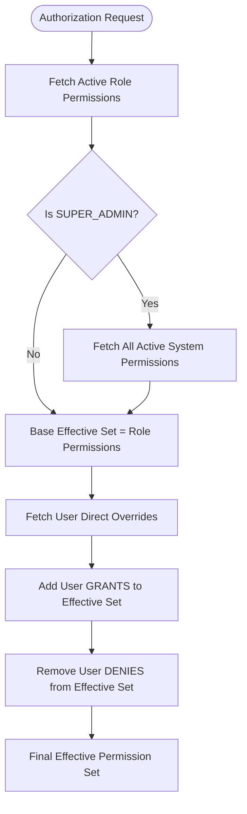
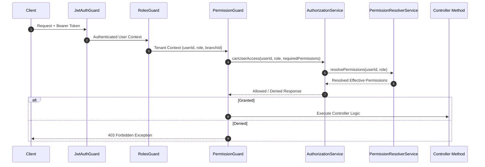

# Enterprise Authorization Platform (Phase 1)

CampusFlow ERP incorporates a centralized, enterprise-grade **Authorization Platform**. It adheres strictly to Anti-Gravity clean architecture principles and acts as the single source of truth for all permission management, resolution, and request authorization across all present and future ERP modules.

---

## Architectural Principles & Design Rationale

### 1. Database-Driven `PermissionCategory` Entity
- **Problem with Enums**: Defining permission categories as a Prisma/TypeScript `enum` creates tight coupling. Every time a new ERP module is added (Hostel, Transport, LMS, CRM, Alumni, Finance, Procurement), developers would be forced to modify Prisma schema files, execute migrations, regenerate the Prisma Client, recompile code, and redeploy the backend.
- **Entity Solution**: `PermissionCategory` is implemented as a standalone database `model` with attributes `id`, `code` (unique), `name`, `description`, `icon`, `displayOrder`, `isSystem`, `isActive`.
- **Zero-Migration Extensibility**: Adding a new ERP module requires zero database migrations or code changes—simply inserting a category record (`PermissionCategory`) and seeding its associated permissions.

### 2. Permissions as Application Capability Contracts
- **Contract Philosophy**: Permissions (e.g., `student.view`, `fees.collect`) represent code-level capability contracts, not user-generated runtime data. Allowing administrators to create arbitrary permission strings from a UI leads to detached permission entries with no underlying controller or service logic.
- **Immutability in Production**: Permissions are version-controlled in seed files and application contracts (`PERMISSIONS` catalog).
- **Administrative Scope**: Administrators manage:
  1. Role-to-Permission assignments (`POST /v1/authorization/roles/:role/permissions`)
  2. User Direct Permission Overrides (`POST /v1/authorization/users/:userId/overrides`)

### 3. Enum Retention for `OverrideType`
- `OverrideType` remains a Prisma enum (`GRANT`, `DENY`). Unlike categories or permissions, `GRANT` and `DENY` represent fixed, fundamental boolean override states embedded directly into the permission resolution algorithm logic.

### 4. Type-Safe Permission Catalog (`PERMISSIONS` `as const`)
- To prevent maintaining duplicate permission lists across TypeScript enums and database seed files, the system exposes a unified immutable catalog object (`PERMISSIONS`) supporting full compile-time IDE autocompletion and type checking:
  ```typescript
  import { PERMISSIONS } from '@/common/constants/permission.constants';

  @RequirePermission(PERMISSIONS.Student.View)
  ```

---

## Permission Resolution Engine

The permission resolution algorithm is centralized inside `PermissionResolverService`.

### Precedence Algorithm



1. **Role Permissions**: Retrieves active permissions mapped to the user's role (`RolePermission`).
2. **SUPER_ADMIN Bypass**: Users with `RoleType.SUPER_ADMIN` automatically resolve to all active system permissions as their base set.
3. **User Grants**: Adds permissions explicitly granted to the user via `UserPermissionOverride` (`type: GRANT`).
4. **User Denies**: Removes permissions explicitly denied to the user via `UserPermissionOverride` (`type: DENY`). User `DENY` overrides both Role permissions and Grants.
5. **Final Effective Set**: Immutable set of allowed permission strings.

---

## Guard Execution Order & Architecture

The global guard sequence configured in `AppModule` ensures strict, step-by-step request validation:



### Order of Execution in `AppModule`:
1. `JwtAuthGuard`: Authenticates bearer JWT token and populates `req.user`.
2. `RolesGuard`: Validates role and populates `req.context` (`userId`, `role`, `organizationId`, branch safety checks).
3. `PermissionGuard` **[NEW]**: Evaluates required route permissions using `AuthorizationService`.
4. `BranchGuard`: Validates branch context and enforces multi-tenant boundaries.
5. `MaintenanceGuard`: Enforces active system maintenance window rules.
6. `AcademicYearGuard`: Validates active academic year context.

---

## Developer Guide

### Protecting Controllers and Routes

Use the `@RequirePermission()` decorator to guard routes:

```typescript
import { Controller, Get, Post } from '@nestjs/common';
import { ApiTags, ApiBearerAuth } from '@nestjs/swagger';
import { RequirePermission } from '@/common/decorators/permission.decorator';
import { PERMISSIONS } from '@/common/constants/permission.constants';

@ApiTags('Applicants')
@ApiBearerAuth()
@Controller('admissions/applicants')
export class ApplicantController {

  @Get()
  @RequirePermission(PERMISSIONS.Admissions.View)
  async findAll() {
    return [];
  }

  @Post()
  @RequirePermission(PERMISSIONS.Admissions.Create)
  async create() {
    return {};
  }

  @Post('batch-approve')
  @RequirePermission([PERMISSIONS.Admissions.Approve, PERMISSIONS.Admissions.Export], { mode: 'ALL' })
  async batchApprove() {
    return {};
  }
}
```

### Swagger Documentation
`@RequirePermission()` automatically registers `x-required-permissions` metadata in the OpenAPI spec documentation.

---

## REST API Specification (`/v1/authorization`)

| Method | Endpoint | Description | Required Permission |
| :--- | :--- | :--- | :--- |
| `GET` | `/v1/authorization/categories` | List permission categories | `settings.view` |
| `GET` | `/v1/authorization/permissions` | List permissions (optional `categoryId` query filter) | `settings.view` |
| `GET` | `/v1/authorization/permissions/:id` | Get permission details | `settings.view` |
| `GET` | `/v1/authorization/roles/:role/permissions` | List permissions mapped to role | `settings.view` |
| `POST` | `/v1/authorization/roles/:role/permissions` | Assign/replace permissions for role | `settings.manage` |
| `GET` | `/v1/authorization/users/:userId/overrides` | List direct user overrides | `settings.view` |
| `POST` | `/v1/authorization/users/:userId/overrides` | Set direct user override (`GRANT`/`DENY`) | `settings.manage` |
| `DELETE` | `/v1/authorization/users/:userId/overrides/:permissionId` | Remove user override | `settings.manage` |
| `GET` | `/v1/authorization/me/effective-permissions` | Get current user's resolved effective permissions | Authenticated |

---

## Audit Integration

All authorization modifications publish domain events to the `EventBus`, automatically captured by `AuditListener` and mapped to module `AUTHORIZATION`:
- `role_permissions.updated`: Captured when role permissions are updated.
- `user_permission_override.updated`: Captured when a user grant or deny override is created/updated.
- `user_permission_override.deleted`: Captured when an override is removed.
- `authorization.permission_denied`: Captured when a request fails permission checks.

---

## Future Extensibility Architecture

### 1. Redis Caching Strategy
In Phase 2, `PermissionResolverService.resolvePermissionsWithCache` will store resolved permissions in Redis under `auth:perm:${userId}` with cache invalidation triggered automatically by `RolePermissionsUpdatedEvent` and `UserPermissionOverrideUpdatedEvent`.

### 2. Dynamic Menu Authorization
`AuthorizationService.getAuthorizedMenuItems` provides the abstraction to filter UI menu trees against the user's resolved `effectivePermissions`.

### 3. HR & Designation Integration
`AuthorizationService.resolveHRPermissions` will merge employee designation permissions into the resolution engine.

### 4. Attribute-Based Access Control (ABAC) & Feature Flags
The clean separation in `AuthorizationService` allows adding condition evaluators (e.g. checking resource owner, time-of-day, or feature flags) without modifying existing guards or API contracts.
