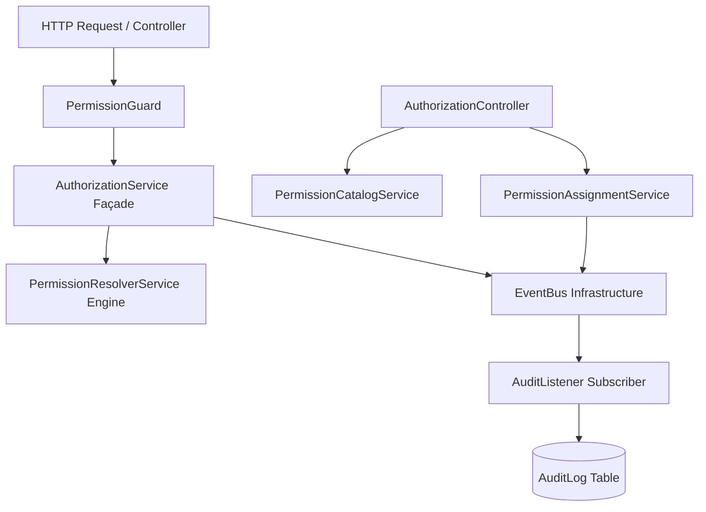
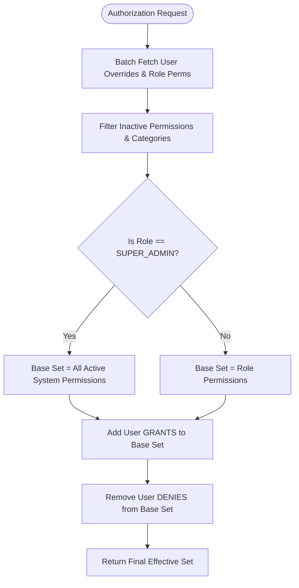
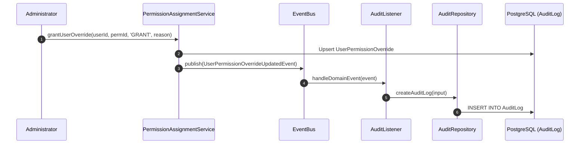

# Enterprise Authorization Platform (Phase 2 — Core Engine)

CampusFlow ERP incorporates a centralized, enterprise-grade **Authorization Platform**. It adheres strictly to Anti-Gravity clean architecture principles and acts as the single source of truth for permission resolution, authorization evaluation, role permission assignment, user permission overrides, and security auditing across all present and future ERP modules.

---

## Architectural Principles & Service Boundaries

Phase 2 establishes clean, decoupled service boundaries within the Authorization Platform:



### 1. `PermissionResolverService` (Core Engine)
- **Role**: Pure permission resolution algorithm engine.
- **Responsibilities**: Computes effective permissions based on Role Permissions, SUPER_ADMIN access, User Grants, and User Denies.
- **Performance**: High-performance batch queries, inactive entity filtering, resolution timing measurement (`resolutionDurationMs`), and clean hooks for future Redis caching.

### 2. `AuthorizationService` (Façade)
- **Role**: Unified authorization decision entry point for all ERP modules.
- **Responsibilities**: Exposes `hasPermission()`, `hasAnyPermission()`, `hasAllPermissions()`, `canUserAccess()`, and `getUserEffectivePermissions()`.
- **Decoupling**: Hides database models, Prisma queries, and resolution logic from business modules.

### 3. `PermissionCatalogService` (Read-Only Catalog)
- **Role**: Query engine for application permission contracts and categories.
- **Responsibilities**: Provides `getCategories()`, `getPermissions()`, `getPermissionById()`, `getPermissionByName()`, and `getPermissionMetadata()`.
- **Contract Philosophy**: Application permissions represent code-backed capability contracts (version-controlled and seeded). Arbitrary runtime permission creation via UI is disabled.

### 4. `PermissionAssignmentService` (Management)
- **Role**: Handles permission assignment and override state changes.
- **Responsibilities**: Performs role permission synchronization (`assignPermissionsToRole`), user overrides (`grantUserOverride`, `denyUserOverride`), and override removals.
- **Diff Computation**: Computes exact state diffs (`addedPermissions`, `removedPermissions`, `previousState` $\rightarrow$ `newState`) and publishes domain events.

---

## Permission Resolution Engine Algorithm



### Resolution Order:
1. **Active Role Permissions**: Retrieves active permissions mapped to the user's role (`RolePermission`).
2. **SUPER_ADMIN Bypass**: `SUPER_ADMIN` inherently resolves to all active system permissions as their base set.
3. **User Grants**: Adds permissions explicitly granted to the user via `UserPermissionOverride` (`type: GRANT`).
4. **User Denies**: Removes permissions explicitly denied to the user via `UserPermissionOverride` (`type: DENY`). Direct user denies take absolute precedence over role permissions and grants.
5. **Final Effective Permission Set**: Returns an immutable set of allowed permission strings.

---

## Domain Events & Audit Infrastructure Integration

The Authorization Platform publishes domain events via `EventBus` without direct dependency on the `AuditModule`. `AuditListener` subscribes to these events and persists audit records:



### Authorization Event Map:

| Event Name | Aggregate Type | Audit Action | Audit Payload & Changes Captured |
| :--- | :--- | :--- | :--- |
| `role_permissions.updated` | `RolePermission` | `UPDATE` | `role`, `addedPermissions`, `removedPermissions`, `currentPermissions`, `previousPermissions`, `updatedBy`, `organizationId`, `branchId` |
| `user_permission_override.updated` | `UserPermissionOverride` | `UPDATE` | `userId`, `permissionId`, `permissionName`, `type` (`GRANT`/`DENY`), `previousState`, `newState`, `reason`, `performedBy`, `organizationId`, `branchId` |
| `user_permission_override.deleted` | `UserPermissionOverride` | `DELETE` | `userId`, `permissionId`, `permissionName`, `previousOverride`, `removedBy`, `organizationId`, `branchId` |
| `authorization.permission_denied` | `AuthorizationCheck` | `EXECUTE` | `userId`, `role`, `requiredPermissions`, `missingPermissions`, `route`, `httpMethod`, `organizationId`, `branchId`, `academicYearId`, `requestId` |

---

## Guard Order in `AppModule`

The global guard sequence configured in `AppModule` ensures strict execution order:
1. `JwtAuthGuard` (Bearer JWT validation & `req.user` attachment)
2. `RolesGuard` (Role hierarchy check & `RequestContext` user/role population)
3. `PermissionGuard` **[NEW]** (Permission evaluation via `AuthorizationService`)
4. `BranchGuard` (Branch context & multi-tenant isolation validation)
5. `MaintenanceGuard` (Active system maintenance window restriction)
6. `AcademicYearGuard` (Academic year context validation)

---

## Developer Guide

### Evaluating Permissions in Services

```typescript
@Injectable()
export class StudentService {
  constructor(private readonly authorizationService: AuthorizationService) {}

  async exportStudents(userId: string, role: RoleType) {
    const hasExport = await this.authorizationService.hasPermission(
      userId,
      role,
      PERMISSIONS.Student.Export,
    );

    if (!hasExport) {
      throw new ForbiddenException('User lacks student export permission');
    }
    // ...
  }
}
```

### Protecting Controller Routes

```typescript
@ApiTags('Applicants')
@ApiBearerAuth()
@Controller('admissions/applicants')
export class ApplicantController {

  @Get()
  @RequirePermission(PERMISSIONS.Admissions.View)
  async findAll() {
    return [];
  }

  @Post()
  @RequirePermission(PERMISSIONS.Admissions.Create)
  async create() {
    return {};
  }
}
```

---

## REST API Specifications (`/v1/authorization`)

| Method | Endpoint | Description | Guard |
| :--- | :--- | :--- | :--- |
| `GET` | `/v1/authorization/categories` | List active permission categories | `@RequirePermission('settings.view')` |
| `GET` | `/v1/authorization/permissions` | List active permissions with category details | `@RequirePermission('settings.view')` |
| `GET` | `/v1/authorization/permissions/:id` | Get permission by ID | `@RequirePermission('settings.view')` |
| `GET` | `/v1/authorization/roles/:role/permissions` | List permissions assigned to role | `@RequirePermission('settings.view')` |
| `POST` | `/v1/authorization/roles/:role/permissions` | Assign/sync permissions for role | `@RequirePermission('settings.manage')` |
| `GET` | `/v1/authorization/users/:userId/overrides` | List direct user overrides | `@RequirePermission('settings.view')` |
| `POST` | `/v1/authorization/users/:userId/overrides` | Set user override (`GRANT` / `DENY`) | `@RequirePermission('settings.manage')` |
| `DELETE` | `/v1/authorization/users/:userId/overrides/:permissionId` | Remove user override | `@RequirePermission('settings.manage')` |
| `GET` | `/v1/authorization/me/effective-permissions` | Get current user's effective permissions | Authenticated |

---

## Logging Strategy

The platform uses Pino structured logging:
- **Resolution**: Logs resolved permission count, user ID, role, and resolution duration (`resolutionDurationMs`).
- **Slow Resolution Detection**: Resolution taking longer than `100ms` triggers a `WARN` log (`🐢 [SLOW PERMISSION RESOLUTION]`).
- **Permission Denied**: Logs `WARN` with missing permissions and user context.
- **Sensitive Data Exclusion**: Never logs JWTs, passwords, tokens, or raw credential strings.

---

## Future Extensibility Hooks

1. **Redis Caching Hook (`resolvePermissionsWithCache`)**:
   - `PermissionResolverService.resolvePermissionsWithCache` provides the hook to query Redis key `auth:perm:${userId}` before executing DB resolution.
2. **HR & Designation Hook (`resolveHRPermissions`)**:
   - `PermissionResolverService.resolveHRPermissions` provides the hook to merge employee designation permissions into effective resolution.
3. **Permission Profiles Hook (`resolvePermissionProfiles`)**:
   - Provides the hook to combine user profile permissions.
4. **Dynamic Menu Integration (`getAuthorizedMenuItems`)**:
   - `AuthorizationService.getAuthorizedMenuItems` provides the abstraction to filter UI menu trees against the user's resolved `effectivePermissions`.
