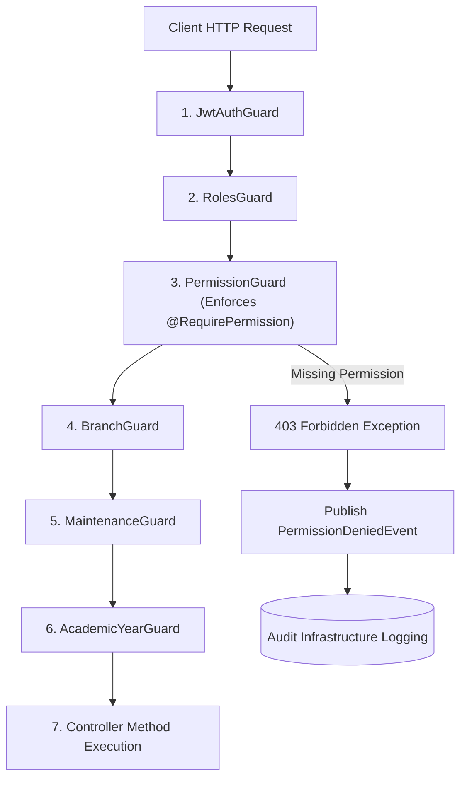

# Enterprise Authorization Platform (Phase 3 — Enforcement & Integration)

CampusFlow ERP incorporates a centralized, enterprise-grade **Authorization Platform**. It adheres strictly to Anti-Gravity clean architecture principles and acts as the single source of truth for permission resolution, authorization evaluation, role permission assignment, user permission overrides, security auditing, and API route enforcement across all ERP modules.

---

## Global Guard Execution Pipeline

The backend request processing pipeline evaluates global guards in strict sequence:



### Pipeline Guard Order:
1. `JwtAuthGuard`: Authenticates bearer JWT token and populates `req.user`.
2. `RolesGuard`: Validates user role and populates `req.context` (`userId`, `role`, `organizationId`, branch safety checks).
3. `PermissionGuard` **[Phase 3 Default Enforcement]**: Evaluates route permission metadata via `AuthorizationService.canUserAccess()`.
4. `BranchGuard`: Validates target branch context and multi-tenant isolation.
5. `MaintenanceGuard`: Enforces active system maintenance rules.
6. `AcademicYearGuard`: Validates target academic year context.

---

## Developer Guide: `@RequirePermission()` Decorator

Use the `@RequirePermission()` decorator from `@/common/decorators/permission.decorator` to protect controllers or route handlers.

### 1. Single Permission Requirement
```typescript
import { Controller, Get } from '@nestjs/common';
import { RequirePermission } from '@/common/decorators/permission.decorator';
import { PERMISSIONS } from '@/common/constants/permission.constants';

@Controller('admissions/applicants')
export class ApplicantController {
  @Get()
  @RequirePermission(PERMISSIONS.Admissions.View)
  async findAll() {
    return [];
  }
}
```

### 2. Multiple Permissions (ALL Mode - Default)
Requires the user to possess **all** listed permissions:
```typescript
@Post('export')
@RequirePermission([PERMISSIONS.Admissions.View, PERMISSIONS.Admissions.Export], { mode: 'ALL' })
async exportApplicants() {
  return [];
}
```

### 3. Multiple Permissions (ANY Mode)
Requires the user to possess **at least one** of the listed permissions:
```typescript
@Get('dashboard')
@RequirePermission([PERMISSIONS.Admissions.View, PERMISSIONS.Student.View], { mode: 'ANY' })
async getDashboard() {
  return {};
}
```

### 4. Swagger OpenAPI Integration
Every endpoint decorated with `@RequirePermission()` automatically injects an OpenAPI extension `x-required-permissions` into the generated Swagger spec without manual documentation duplication.

---

## Protected Module Reference Matrix

| Module | Controller | Protected Endpoints | Required Permission |
| :--- | :--- | :--- | :--- |
| **Organizations** | `OrganizationController` | `GET /v1/organizations`<br>`POST/PATCH/DELETE /v1/organizations/*` | `settings.view`<br>`settings.manage` |
| **Branches** | `BranchController` | `GET /v1/branches`<br>`POST/PATCH/DELETE /v1/branches/*` | `settings.view`<br>`settings.manage` |
| **Academic Years** | `AcademicYearController` | `GET /v1/academic-years`<br>`POST/PATCH/DELETE /v1/academic-years/*` | `settings.view`<br>`settings.manage` |
| **Programs** | `ProgramController` | `GET /v1/programs`<br>`POST/PATCH/DELETE /v1/programs/*` | `settings.view`<br>`settings.manage` |
| **Academic Units** | `AcademicUnitController` | `GET /v1/academic-units`<br>`POST/PATCH/DELETE /v1/academic-units/*` | `settings.view`<br>`settings.manage` |
| **Admissions** | `ApplicantController` | `GET /v1/admissions/applicants`<br>`POST /v1/admissions/applicants`<br>`PATCH /v1/admissions/applicants/:id`<br>`DELETE /v1/admissions/applicants/:id` | `admissions.view`<br>`admissions.create`<br>`admissions.update`<br>`admissions.delete` |
| **System Settings** | `SystemSettingsController` | `GET /v1/system-settings`<br>`POST/PATCH /v1/system-settings/*` | `system.view`<br>`system.manage` |
| **Maintenance** | `MaintenanceController` | `GET /v1/maintenance-rules`<br>`POST/PATCH/DELETE /v1/maintenance-rules/*` | `system.view`<br>`system.maintenance` |

---

## Migration Guide for Future ERP Modules

When introducing a new ERP module (Hostel, Transport, LMS, CRM, Procurement, Finance):

1. **Add Permission Contracts**:
   - Update `PERMISSIONS` catalog in `src/common/constants/permission.constants.ts`.
2. **Seed Categories & Permissions**:
   - Add new category and permissions to `src/infrastructure/database/seeder.service.ts`.
3. **Decorate Module Controllers**:
   - Add `@RequirePermission(PERMISSIONS.<Domain>.<Action>)` to route handlers.
4. **Write Tests**:
   - Add unit and integration tests verifying authorized access and unauthorized 403 Forbidden rejections.

---

## Security Audit & Logging

When permission evaluation fails:
1. `PermissionGuard` logs `WARN` with missing permissions and user context.
2. `AuthorizationService` publishes `PermissionDeniedEvent` to `EventBus`.
3. `AuditListener` captures event and persists an `AuditLog` entry:
   - Module: `AUTHORIZATION`
   - Action: `EXECUTE`
   - Status: `FAILED`
   - Severity: `WARNING`
   - Context: `userId`, `role`, `organizationId`, `branchId`, `academicYearId`, `requestId`, `route`, `httpMethod`.
