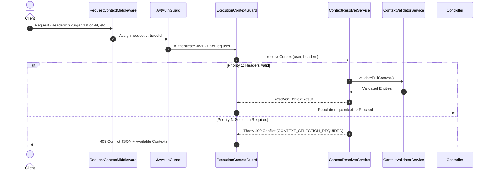

# Enterprise Execution Context Platform

## Architecture Overview

The **Enterprise Execution Context Platform** serves as the single source of truth for resolving, validating, and injecting the active **Organization**, **Branch**, and **Academic Year** for every authenticated request across CampusFlow ERP.

```
Request
  │
  ▼
RequestContextMiddleware (requestId, traceId)
  │
  ▼
JwtAuthGuard (authenticates identity -> req.user)
  │
  ▼
RolesGuard
  │
  ▼
PermissionGuard
  │
  ▼
ExecutionContextGuard (resolves & validates execution context -> req.context)
  │
  ▼
Controller -> Service -> Repository
```

## Guiding Architectural Principles

- **Stateless**: The backend NEVER persists an active execution context in the database or Redis session.
- **Request-Scoped**: Each request resolves and validates its own execution context independently.
- **Header-Driven**: Optional context headers (`X-Organization-Id`, `X-Branch-Id`, `X-Academic-Year-Id`) communicate the client's requested scope.
- **Multi-Tenant Aware**: Strictly enforces organization and branch boundaries to prevent tenant escape and cross-tenant access.
- **Zero Breaking Changes**: Completely backward compatible with existing authentication and authorization modules.

---

## Platform Responsibilities & Structure

The platform is located at `src/modules/context/` and consists of:

```
src/modules/context/
├── context.module.ts
├── context.service.ts
├── constants/
│   └── context.constants.ts
├── dto/
│   ├── context-response.dto.ts
│   └── context-selection-required.dto.ts
├── guards/
│   └── execution-context.guard.ts
├── interfaces/
│   └── execution-context.interface.ts
└── services/
    ├── context-discovery.service.ts
    ├── context-validator.service.ts
    └── context-resolver.service.ts

test/ (centralized test layout)
├── unit/
│   └── context/
│       ├── context-discovery.service.spec.ts
│       ├── context-resolver.service.spec.ts
│       ├── context-validator.service.spec.ts
│       └── execution-context.guard.spec.ts
└── integration/
    └── context/
        ├── auth-me.context.spec.ts
        ├── execution-context.spec.ts
        └── context-selection.spec.ts
```

---

## Strict Architectural Separation: Identity vs Execution Context

CampusFlow ERP enforces a strict architectural boundary between **Identity** and **Execution Context**:

- **Authentication** answers: *"Who is the user?"*
- **Execution Context Platform** answers: *"Where is the user currently operating?"*

### `req.user` (Identity Only)
Contains only authenticated identity information. No execution scope belongs here:
```typescript
req.user = {
  userId: string,
  role: RoleType,
  permissions: string[],
  // authentication metadata
}
```

### `req.context` (Execution Scope Only)
Contains only the active request execution scope:
```typescript
req.context = {
  organizationId: "018f3a5b-7c9d-7e8f-9a0b-1c2d3e4f5a6b",
  branchId: "018f3a5b-7c9d-7e8f-9a0b-1c2d3e4f5a6c",
  academicYearId: "018f3a5b-7c9d-7e8f-9a0b-1c2d3e4f5a6d",
  programId: null,      // future expansion
  departmentId: null,   // future expansion
  campusId: null,       // future expansion
}
```

> [!IMPORTANT]
> **Architectural Rule**: Downstream business modules (Admissions, Students, HR, Fees, Attendance, etc.) must consume execution scope exclusively from `req.context`. They must **NEVER** read execution scope from `req.user` or HTTP headers directly.

---

## Deterministic Resolution Algorithm

### Priority 1: Header Resolution
When HTTP headers are present:
- `X-Organization-Id`
- `X-Branch-Id`
- `X-Academic-Year-Id`

The system validates each supplied identifier against the database and user authorization. If all supplied headers are valid, `req.context` is populated with `source: HEADER`.

### Priority 2: Automatic Resolution
When headers are missing (or partially supplied), the platform auto-resolves if:
- User has access to **exactly one active Organization**.
- User has access to **exactly one active Branch** in that Organization.
- The Branch has **exactly one active/selected Academic Year**.

### Priority 3: Selection Required (HTTP 409 Conflict)
When ambiguity exists (e.g. `SUPER_ADMIN` or `ORG_ADMIN` with multiple available branches/organizations) and explicit headers are omitted, the backend returns:

**HTTP 409 Conflict**
```json
{
  "statusCode": 409,
  "error": "CONTEXT_SELECTION_REQUIRED",
  "message": "Execution context must be selected.",
  "availableOrganizations": [...],
  "availableBranches": [...],
  "availableAcademicYears": [...]
}
```

---

## Validation Pipeline

For every context resolution, the platform executes a 10-step validation chain via `ContextValidatorService`:

1. **Organization Exists**: Verified in DB.
2. **Organization Active**: Must have `status = ACTIVE`.
3. **User Access to Organization**: Super Admin has access to all active orgs; other roles must match assigned `organizationId`.
4. **Branch Exists**: Verified in DB.
5. **Branch Belongs to Organization**: `branch.organizationId === organization.id`.
6. **Branch Active**: `branch.isActive === true` and `branch.isDeleted === false`.
7. **User Access to Branch**: Super Admin & Org Admin have access to all active branches in org; restricted roles must match assigned `branchId`.
8. **Academic Year Exists**: Verified in DB.
9. **Academic Year Belongs to Branch**: `academicYear.branchId === branch.id`.
10. **Academic Year Active**: `academicYear.isDeleted === false` and (`academicYear.isActive === true` or `isSelected === true`).

---

## API Extensions (`GET /v1/auth/me`)

The `/v1/auth/me` endpoint returns extended profile, permission, and context data:

```json
{
  "success": true,
  "message": "Profile retrieved successfully",
  "data": {
    "user": {
      "id": "...",
      "fullName": "...",
      "email": "...",
      "role": "ORG_ADMIN"
    },
    "role": "ORG_ADMIN",
    "permissions": ["student.view", "branch.manage"],
    "context": {
      "organizationId": "...",
      "branchId": "...",
      "academicYearId": "..."
    },
    "availableOrganizations": [...],
    "availableBranches": [...],
    "availableAcademicYears": [...]
  }
}
```

---

## Audit Integration

The Execution Context Platform publishes targeted domain events via `EventBus`:
- `context.validation_failed`: Emitted on invalid header or entity mismatch.
- `context.access_denied`: Emitted on unauthorized cross-tenant attempts.
- `context.selection_required`: Emitted when ambiguity triggers 409 Conflict.

Events are registered in `AuditListener` and categorized under module `'CONTEXT'` in `AuditEventMapper`.

---

## Sequence Diagram (Mermaid)



---

## Future Multi-Branch Staff & Cache Integration

- **Multi-Branch Staff Support**: Design supports multi-branch user assignment matrices without modifying current single-branch schema bindings.
- **Cache Integration**: Interface points allow wrapping `ContextDiscoveryService` and `ContextValidatorService` with Redis query caching in future phases.
