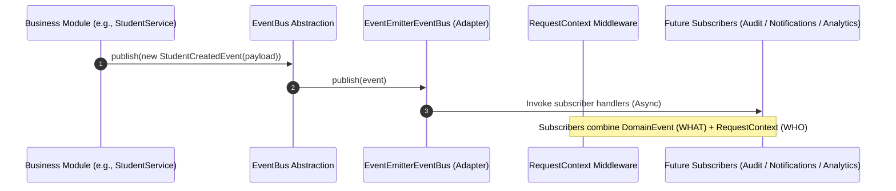

# Event-Driven Architecture Infrastructure

CampusFlow ERP incorporates an enterprise-grade, decoupled **Event-Driven Infrastructure** built upon the **Dependency Inversion Principle**.

Business modules (e.g., Admissions, Academic, User, Auth) depend strictly on the `EventBus` abstraction. They publish domain events without knowing how or where events are delivered. The underlying event transport mechanism (`EventEmitter`, `BullMQ`, `Kafka`, `RabbitMQ`, `AWS SQS`) is encapsulated inside `EventsModule` and can be swapped without modifying a single line of business logic.

---

## Architecture Overview



### Core Design Principles

1. **Decoupled Business Domain**: Business services depend solely on the abstract `EventBus` class provided via NestJS Dependency Injection.
2. **Context Isolation**: `DomainEvent` represents **WHAT** happened (`eventId`, `eventName`, `occurredAt`, `aggregateId`, `aggregateType`, `version`, `metadata`). It does **NOT** duplicate context information (**WHO** caused it: `userId`, `requestId`, `branchId`, `organizationId`). Subscribers combine `DomainEvent` with CampusFlow's existing `RequestContext` middleware.
3. **Fault-Tolerant Subscriber Execution**: Handlers execute asynchronously with isolated error boundaries. A failure in one subscriber never crashes the event bus or disrupts other subscribers.
4. **UUID v7 Event Tracking**: Every domain event is automatically assigned a time-ordered, sortable UUID v7 (`eventId`).

---

## Folder Structure

```text
src/
├── common/
│   └── events/
│       ├── domain-event.base.ts        # Abstract DomainEvent base class (UUID v7, timestamps, metadata)
│       ├── index.ts                    # Barrel exports
│       └── examples/
│           ├── student-created.event.ts # Example domain event
│           ├── branch-created.event.ts  # Example domain event
│           └── user-logged-in.event.ts  # Example domain event
└── infrastructure/
    └── events/
        ├── event-bus.interface.ts      # Abstract EventBus definition & EventHandler type
        ├── events.module.ts            # Global NestJS Module exporting EventBus provider
        ├── index.ts                    # Barrel exports
        └── adapters/
            └── event-emitter.event-bus.ts # In-memory EventEmitter implementation
```

---

## Developer Guide

### 1. Creating a New Domain Event

Inherit from `DomainEvent` and call `super()` with event parameters:

```typescript
import { DomainEvent } from '@/common/events/domain-event.base';

export interface FeeCollectedPayload {
  receiptId: string;
  studentId: string;
  amount: number;
}

export class FeeCollectedEvent extends DomainEvent {
  static readonly EVENT_NAME = 'fee.collected';
  readonly payload: FeeCollectedPayload;

  constructor(payload: FeeCollectedPayload, metadata?: Record<string, any>) {
    super({
      eventName: FeeCollectedEvent.EVENT_NAME,
      aggregateId: payload.receiptId,
      aggregateType: 'FeeReceipt',
      metadata,
    });
    this.payload = payload;
  }
}
```

---

### 2. Publishing Events from a Business Service

Inject `EventBus` via constructor injection and publish domain events:

```typescript
import { Injectable } from '@nestjs/common';
import { EventBus } from '@/infrastructure/events/event-bus.interface';
import { FeeCollectedEvent } from './events/fee-collected.event';

@Injectable()
export class FeeService {
  constructor(private readonly eventBus: EventBus) {}

  async collectFee(receiptData: any) {
    // 1. Process business logic & DB write
    const receipt = await this.prisma.feeReceipt.create({ data: receiptData });

    // 2. Publish Domain Event
    await this.eventBus.publish(
      new FeeCollectedEvent({
        receiptId: receipt.id,
        studentId: receipt.studentId,
        amount: receipt.amount,
      }),
    );

    return receipt;
  }
}
```

---

### 3. Registering Subscribers (e.g. Future Audit, Notifications, Analytics)

Subscribers register with `EventBus` upon initialization:

```typescript
import { Injectable, OnModuleInit } from '@nestjs/common';
import { EventBus } from '@/infrastructure/events/event-bus.interface';
import { StudentCreatedEvent } from '@/common/events/examples/student-created.event';

@Injectable()
export class NotificationSubscriber implements OnModuleInit {
  constructor(private readonly eventBus: EventBus) {}

  onModuleInit() {
    this.eventBus.subscribe<StudentCreatedEvent>(
      StudentCreatedEvent.EVENT_NAME,
      this.handleStudentCreated.bind(this),
    );
  }

  private async handleStudentCreated(event: StudentCreatedEvent) {
    // Send welcome email / SMS notification
  }
}
```

---

## Future Transport Extension (BullMQ / Kafka / RabbitMQ)

To switch from the local `EventEmitter` adapter to a distributed queue like `BullMQ` or `Kafka`, create a new adapter implementing `EventBus` and update `EventsModule`:

```typescript
// src/infrastructure/events/adapters/kafka.event-bus.ts
@Injectable()
export class KafkaEventBus implements EventBus {
  async publish<T extends DomainEvent>(event: T): Promise<void> {
    // Produce event to Kafka topic
  }
  // ...
}

// src/infrastructure/events/events.module.ts
@Global()
@Module({
  providers: [
    {
      provide: EventBus,
      useClass: KafkaEventBus, // Swapped seamlessly!
    },
  ],
  exports: [EventBus],
})
export class EventsModule {}
```

No business modules, controllers, or services require any changes when swapping event transport implementations.
