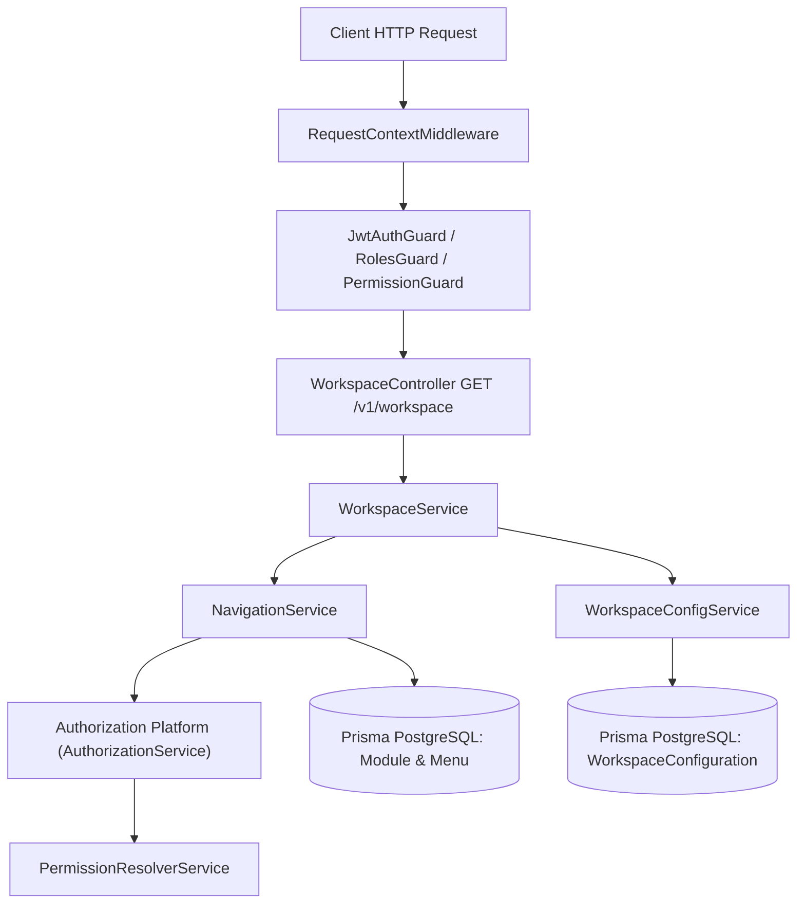
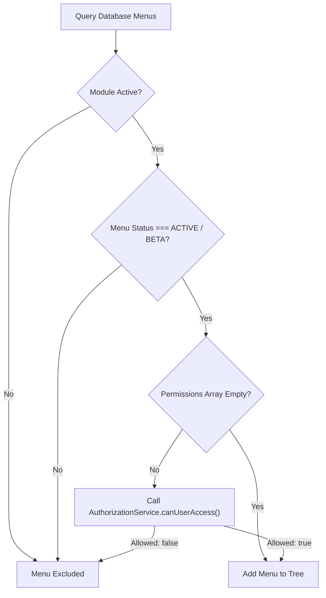

# CampusFlow ERP — Workspace Platform (Phase 1: Foundation & Navigation Infrastructure)

The **Workspace Platform** acts as the presentation orchestration layer for CampusFlow ERP. It consumes the **Authorization Platform** (`AuthorizationService`) for security and permission evaluation, and uses **RequestContext** for multi-tenant active context resolution and client platform detection.

---

## 1. Architectural Principles & Dependency Direction

The Workspace Platform strictly separates presentation orchestration from security enforcement:



> [!IMPORTANT]
> **Strict Dependency Rule**:
> Workspace $\rightarrow$ Authorization $\rightarrow$ Permission Resolver.
> Authorization NEVER depends on Workspace. Workspace is purely a presentation layer and contains **zero custom security logic**.

---

## 2. Client Detection Infrastructure

Client detection is performed cleanly through HTTP headers validated in `RequestContextMiddleware`:

- `X-Client-App`: Client application identifier (e.g. `campusflow-web`, `campusflow-mobile-ios`). Default: `campusflow-web`.
- `X-Client-Version`: Version string (e.g. `1.0.0`). Default: `1.0.0`.
- `X-Platform`: Platform type (`WEB`, `MOBILE`, `DESKTOP`). Default: `WEB`.

Platform parameters are **never** placed inside JWT tokens or query parameters (e.g. `/workspace?platform=MOBILE` is prohibited). Platform selection is derived exclusively from validated `RequestContext`.

---

## 3. Database Schema

Phase 1 introduces normalized schema definitions in `prisma/modules/workspace/workspace.prisma`:

### `Module`
- `code`: Unique string identifier (e.g. `'ADMISSIONS'`, `'FEES'`, `'SETTINGS'`).
- `name`: Display title.
- `isActive`: Boolean flag. Disabling a module automatically hides all navigation menus beneath it.

### `Menu`
- `code`: Unique menu code (e.g. `'ADMISSIONS_APPLICANTS'`).
- `moduleId`: Foreign key to `Module`.
- `parentId`: Nullable self-reference for nested submenus.
- `route`: Client route path (e.g. `'/admissions/applicants'`).
- `permissions`: Required permission names array (e.g. `['admissions.view']`).
- `permissionMode`: Evaluation mode (`ALL` or `ANY`).
- `status`: Extensible `MenuStatus` enum (`ACTIVE`, `DISABLED`, `COMING_SOON`, `BETA`, `HIDDEN`, `DEPRECATED`).

### `WorkspaceConfiguration`
- `scopeType`: `WorkspaceScopeType` enum (`PRODUCT`, `ORGANIZATION`, `BRANCH`, `ROLE`, `USER`).
- `scopeId`: Scope identifier (Org ID, Branch ID, Role Name, or User ID; `null` for `PRODUCT`).
- `navigationPreferences`: JSON object (e.g., `{ sidebarCollapsed: false, defaultRoute: '/dashboard' }`).
- `clientPreferences`: JSON object (e.g., `{ theme: 'system', locale: 'en' }`).

---

## 4. Menu Visibility Pipeline

The visibility algorithm determines which menus appear in the user's workspace navigation tree:



---

## 5. Layered Workspace Configuration Resolution

Workspace configuration resolution uses deterministic layered inheritance merging:

$$\text{Product Defaults} \rightarrow \text{Organization} \rightarrow \text{Branch} \rightarrow \text{Role} \rightarrow \text{User Workspace Configuration}$$

Higher precedence layers override lower layers sequentially.

---

## 6. Workspace Infrastructure API

### `GET /v1/workspace`
Returns workspace presentation data:

```json
{
  "data": {
    "activeContexts": {
      "organizationId": "019fa012-...",
      "branchId": "019fa013-...",
      "academicYearId": "019fa014-..."
    },
    "client": {
      "clientApp": "campusflow-web",
      "clientVersion": "1.0.0",
      "platform": "WEB"
    },
    "configuration": {
      "navigationPreferences": {
        "sidebarCollapsed": false,
        "themeMode": "dark"
      },
      "clientPreferences": {
        "theme": "dark",
        "locale": "en"
      }
    },
    "navigation": [
      {
        "id": "menu-adm-1",
        "code": "ADMISSIONS_APPLICANTS",
        "displayName": "Applicants List",
        "route": "/admissions/applicants",
        "icon": "users",
        "children": []
      }
    ],
    "metadata": {
      "resolvedAt": "2026-07-28T20:00:00.000Z",
      "totalVisibleMenus": 12,
      "menuTreeDepth": 2
    }
  },
  "message": "Workspace layout resolved successfully"
}
```

> [!NOTE]
> **Zero Live Business Data**: Phase 1 workspace responses return no widget counts, fee summaries, attendance counts, or report data. Widget data belongs to future Workspace phases.

---

## 7. Future Roadmap

- **Phase 2**: Dashboard Widget Infrastructure & Widget Registry.
- **Phase 3**: User Favorites, Recent Pages & Personalization.
- **Phase 4**: Workspace Announcements, Banners & Dynamic Quick Actions.
