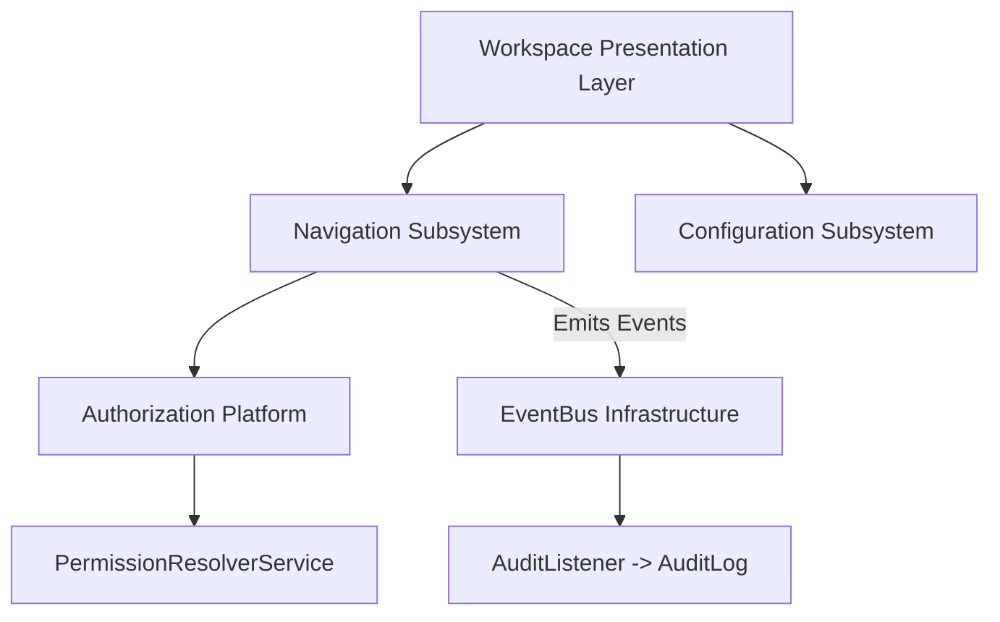

# CampusFlow ERP — Workspace Platform Documentation

The **Workspace Platform** acts as the presentation orchestration layer for CampusFlow ERP. It consumes the **Authorization Platform** (`AuthorizationService`) for security and permission evaluation, and uses **RequestContext** for multi-tenant active context resolution and client platform detection.

---

## Workspace Subsystems & Detailed Documentation

- [1. Platform Overview & Layout Orchestration](file:///d:/ERP/backend/docs/core/workspace/overview.md)
  - Architectural principles, dependency direction, client platform detection (`X-Client-App`, `X-Client-Version`, `X-Platform`), and `GET /v1/workspace` API payload.

- [2. Navigation Subsystem & Administration](file:///d:/ERP/backend/docs/core/workspace/navigation.md)
  - Menu Visibility Pipeline, Depth-First Search (DFS) cycle prevention, 3-level max depth rule, route uniqueness, tree builder, `INavigationCache` strategy, and Super Admin Menu REST APIs.

- [3. Module Subsystem & Lifecycle](file:///d:/ERP/backend/docs/core/workspace/module.md)
  - Business capability module boundaries, activation state machine (`ACTIVE`, `INACTIVE`, `ARCHIVED`), cascade menu visibility effects, and Super Admin Module REST APIs.

- [4. Workspace Configuration & Layered Inheritance](file:///d:/ERP/backend/docs/core/workspace/configuration.md)
  - 5-level layered configuration inheritance resolution model (`PRODUCT` $\rightarrow$ `ORGANIZATION` $\rightarrow$ `BRANCH` $\rightarrow$ `ROLE` $\rightarrow$ `USER`), scope definitions, and configuration REST API.

---

## Core Dependency Principles

> [!IMPORTANT]
> **Strict Dependency Rule**:
> Workspace $\rightarrow$ Authorization $\rightarrow$ Permission Resolver.
> Authorization NEVER depends on Workspace. Workspace contains zero custom security or role assignment logic.
