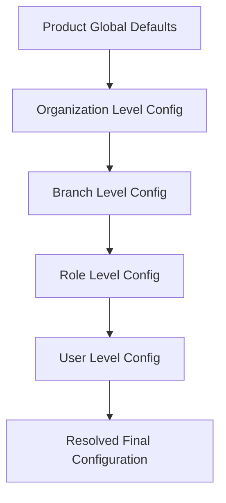

# Workspace Configuration & Layered Inheritance

## 1. Overview

Workspace configurations govern client UI preferences (sidebar state, theme mode, font size, locale, default route). Configurations use a 5-level **Layered Inheritance Merging** model.

---

## 2. Layered Inheritance Resolution Model

$$\text{PRODUCT (Global Default)} \longrightarrow \text{ORGANIZATION} \longrightarrow \text{BRANCH} \longrightarrow \text{ROLE} \longrightarrow \text{USER}$$

Higher precedence layers override lower layers sequentially during resolution:



---

## 3. Configuration Scope Schema

`WorkspaceConfiguration` database model:

- `scopeType`: `PRODUCT`, `ORGANIZATION`, `BRANCH`, `ROLE`, `USER`.
- `scopeId`: Target scope UUID (or `null` for global `PRODUCT` scope).
- `navigationPreferences`: JSON payload (e.g. `{ sidebarCollapsed: false, defaultRoute: '/dashboard' }`).
- `clientPreferences`: JSON payload (e.g. `{ theme: 'system', locale: 'en' }`).

---

## 4. Administrative REST API

### `POST /v1/workspace/configuration`
- **Permissions**: `PERMISSIONS.Settings.Manage` (Super Admin Only)
- **Body**:
```json
{
  "scopeType": "ROLE",
  "scopeId": "STAFF",
  "navigationPreferences": {
    "denseMode": true
  },
  "clientPreferences": {
    "theme": "dark"
  }
}
```

### `GET /v1/workspace/configuration/:scopeType`
- **Permissions**: `PERMISSIONS.Settings.Manage` (Super Admin Only) — same guard as the
  write endpoint above.
- **Query**: `scopeId` (optional — omit for the `PRODUCT` layer, which has none)
- Looks a layer up by the exact `scopeType`/`scopeId` key the `POST` above
  upserts against — **not** the merged configuration a user in that scope
  effectively sees (that is `GET /v1/workspace`'s `configuration` field,
  §3 above). Returns `404` if no layer has ever been saved for that exact
  scope.
- **Response** (`WorkspaceConfigurationDto`):
```json
{
  "id": "018f3a5b-...",
  "scopeType": "ROLE",
  "scopeId": "STAFF",
  "navigationPreferences": { "denseMode": true },
  "clientPreferences": { "theme": "dark" },
  "isActive": true,
  "createdById": "018f3a5b-...",
  "createdAt": "2026-08-21T00:00:00.000Z",
  "updatedAt": "2026-08-21T00:00:00.000Z"
}
```
