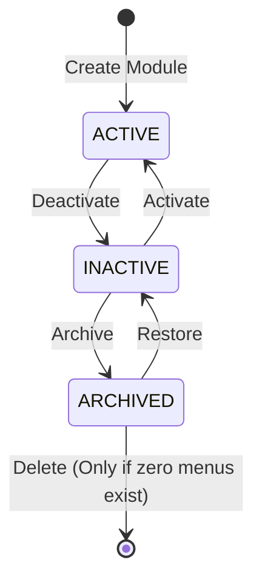

# Module Subsystem & Lifecycle Management

## 1. Overview

A **Module** represents a top-level business capability boundary in CampusFlow ERP (e.g. `ADMISSIONS`, `STUDENTS`, `FEES`, `SETTINGS`, `COMMUNICATION`).

---

## 2. Module Lifecycle State Machine

> [!WARNING]
> **Cascade Visibility Effect**: Setting `Module.isActive = false` automatically hides all navigation menus underneath that module across all user workspaces.

---

## 3. Administrative REST APIs

### Super Admin Module Operations

- `GET /v1/admin/navigation/modules`: List all registered modules with menu counts.
- `GET /v1/admin/navigation/modules/:id`: Get module details.
- `POST /v1/admin/navigation/modules`: Register new module.
- `PATCH /v1/admin/navigation/modules/:id`: Update name, icon, or display order.
- `PATCH /v1/admin/navigation/modules/:id/status`: Toggle `isActive` status.
- `DELETE /v1/admin/navigation/modules/:id`: Delete module (blocked if menus exist).
