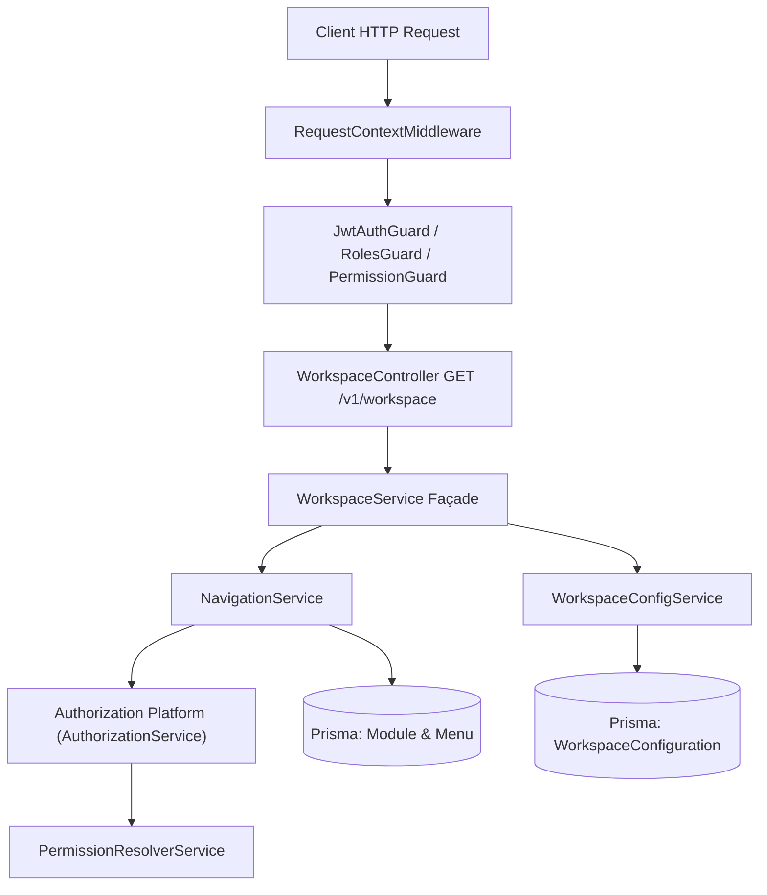

# Workspace Platform — Architectural Overview

## 1. Executive Summary

The **Workspace Platform** is the central presentation orchestration layer of CampusFlow ERP. Designed according to Anti-Gravity Clean Architecture, the Workspace Platform acts purely as an orchestrator, constructing the authenticated user's UI layout, navigation tree, client settings, and subsystem metadata.

It consumes:
- **Authorization Platform** (`AuthorizationService`) for security evaluation (zero duplicate permission logic).
- **RequestContext** for active tenant resolution (`organizationId`, `branchId`, `academicYearId`) and client platform detection (`x-client-app`, `x-client-version`, `x-platform`).
- **Workspace Subsystems** (Navigation, Configuration, and future Dashboard Widgets, Personalization, Favorites).

---

## 2. Platform Boundaries & Dependency Flow



### Dependency Rules

1. **Unidirectional Dependency**: `Workspace` $\rightarrow$ `Navigation` $\rightarrow$ `Authorization` $\rightarrow$ `PermissionResolver`.
2. **Zero Duplicate Security Logic**: Navigation never determines whether a user possesses a permission. It calls `AuthorizationService.canUserAccess()`.
3. **Zero Business Data Leaks**: Phase 1 workspace responses return presentation metadata only. Live business widget data (fees collected, student counts) belong to future Widget Subsystems.

---

## 3. Client Platform Detection Infrastructure

Client detection is performed in `RequestContextMiddleware` using HTTP request headers:

| Header Name | Type | Default Value | Description |
| :--- | :--- | :--- | :--- |
| `X-Client-App` | String | `campusflow-web` | Identifier for the client app (e.g. `campusflow-web`, `campusflow-mobile-ios`). |
| `X-Client-Version` | String | `1.0.0` | Client application release version string. |
| `X-Platform` | Enum | `WEB` | Platform category (`WEB`, `MOBILE`, `DESKTOP`). |

> [!IMPORTANT]
> Platform selection is derived exclusively from validated headers. Placing platform indicators inside JWT tokens or query strings (`/workspace?platform=MOBILE`) is strictly prohibited.

---

## 4. Master Layout API Contract

### `GET /v1/workspace`

```json
{
  "statusCode": 200,
  "message": "Workspace layout resolved successfully",
  "data": {
    "activeContexts": {
      "organizationId": "019fa012-...",
      "branchId": "019fa013-...",
      "academicYearId": "019fa014-..."
    },
    "client": {
      "clientApp": "campusflow-web",
      "clientVersion": "1.0.0",
      "platform": "WEB"
    },
    "configuration": {
      "navigationPreferences": {
        "sidebarCollapsed": false,
        "themeMode": "system"
      },
      "clientPreferences": {
        "theme": "system",
        "locale": "en"
      }
    },
    "navigation": [
      {
        "id": "menu-adm-1",
        "code": "ADMISSIONS_APPLICANTS",
        "displayName": "Applicants List",
        "route": "/admissions/applicants",
        "icon": "users",
        "children": []
      }
    ],
    "metadata": {
      "resolvedAt": "2026-07-28T20:30:00.000Z",
      "totalVisibleMenus": 12,
      "menuTreeDepth": 2
    }
  }
}
```
