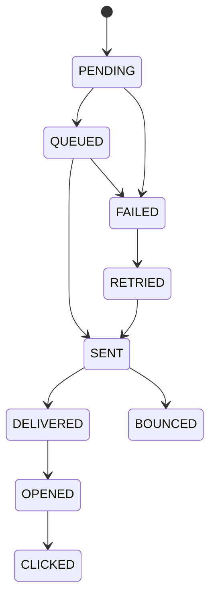

# Communication Delivery Log & Operational Analytics

The `DeliveryLog` table records the operational lifecycle of every outbound communication across all channels (Email, SMS, WhatsApp, Push, In-App).

---

## 1. Why DeliveryLog ≠ AuditLog

- **AuditLog** answers **WHO did WHAT and WHEN** from a business auditing perspective (e.g. "User Admin updated Student Grade on 2026-07-26").
- **DeliveryLog** answers **WAS IT SENT, DELIVERED, OPENED, OR BOUNCED** from a technical and network perspective (e.g. "Email to user@example.com using SMTP provider took 120ms and returned 250 OK").

---

## 2. Delivery Status State Machine



---

## 3. Storage & Analytics Performance Optimization

The `DeliveryLog` schema is optimized for analytical aggregation without foreign key locking bottlenecks on business entities:

```sql
-- Core Operational Indexes
CREATE INDEX "DeliveryLog_recipient_idx" ON "DeliveryLog"("recipient");
CREATE INDEX "DeliveryLog_channel_idx" ON "DeliveryLog"("channel");
CREATE INDEX "DeliveryLog_status_idx" ON "DeliveryLog"("status");
CREATE INDEX "DeliveryLog_provider_idx" ON "DeliveryLog"("provider");
CREATE INDEX "DeliveryLog_createdAt_idx" ON "DeliveryLog"("createdAt");
```

### Metrics Calculated by `DeliveryLogService.getAnalytics`:
$$\text{Delivery Rate (\%)} = \frac{\text{SENT} + \text{DELIVERED}}{\text{Total Processed}} \times 100$$

$$\text{Failure Rate (\%)} = \frac{\text{FAILED}}{\text{Total Processed}} \times 100$$

$$\text{Bounce Rate (\%)} = \frac{\text{BOUNCED}}{\text{Total Processed}} \times 100$$
