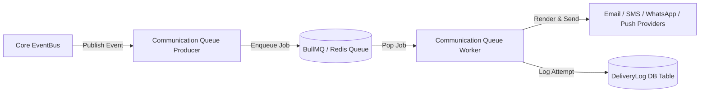

# Future Transport & Integration Roadmap

This document outlines the architectural roadmap for migrating the Communication Infrastructure from synchronous `EventBus` execution to distributed background message queues and external enterprise providers.

---

## 1. Background Message Queue Migration (BullMQ / Redis / Kafka)

### Current Architecture:
`EventBus` (EventEmitter) $\longrightarrow$ Synchronous Subscriber Execution $\longrightarrow$ Direct Provider Dispatch.

### Target Queue Architecture:


### Migration Steps:
1. Replace `EventEmitterEventBus` with `BullMQEventBus` or `KafkaEventBus` in `src/infrastructure/events/events.module.ts`.
2. Wrap subscriber dispatch inside BullMQ processor background jobs.
3. Zero changes are needed in `CommunicationSubscriber`, `TemplateService`, or business domain services.

---

## 2. External Provider Expansion

| Channel | Target Enterprise Provider | Adapter Implementation File |
| :--- | :--- | :--- |
| **Email** | AWS SES | `src/modules/communication/providers/ses/aws-ses-email.provider.ts` |
| | Resend | `src/modules/communication/providers/resend/resend-email.provider.ts` |
| | SendGrid | `src/modules/communication/providers/sendgrid/sendgrid-email.provider.ts` |
| **SMS** | Twilio SMS | `src/modules/communication/providers/twilio/twilio-sms.provider.ts` |
| | MSG91 (India) | `src/modules/communication/providers/msg91/msg91-sms.provider.ts` |
| **WhatsApp** | Meta WhatsApp Business API | `src/modules/communication/providers/meta/meta-whatsapp.provider.ts` |
| **Push** | Firebase Cloud Messaging (FCM) | `src/modules/communication/providers/firebase/firebase-push.provider.ts` |

---

## 3. Provider Failover & Dead Letter Queue (DLQ) Strategy

```mermaid
graph TD
    Job[Dispatch Outbound Message] --> Primary[Try Primary Provider (e.g. AWS SES)]
    Primary -->|Success| Complete[Log Success in DeliveryLog]
    Primary -->|Failure| Failover{Retry Count < Max?}
    Failover -->|Yes| Secondary[Try Secondary Provider (e.g. SMTP / Resend)]
    Secondary -->|Success| Complete
    Secondary -->|Failure| IncrementRetry[Increment Retry Count & Backoff]
    Failover -->|No / Exhausted| DLQ[(Dead Letter Queue / Failed Delivery Log)]
```
