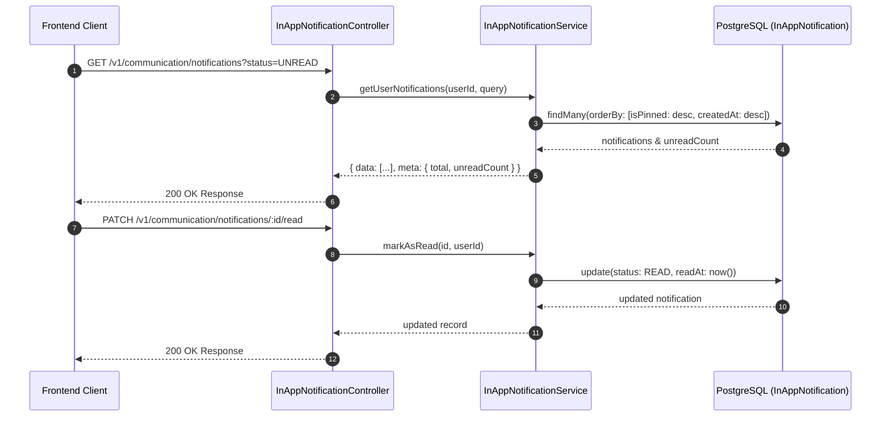

# In-App Notification Center Architecture

The **In-App Notification Center** provides real-time and persistent in-app notifications for users across web and mobile ERP client interfaces.

---

## 1. Feature Specifications

- **Notification States**: `UNREAD`, `READ`, `ARCHIVED`.
- **Pinning**: `isPinned = true` keeps critical announcements pinned at the top of the user feed regardless of creation date.
- **Priority Levels**: `LOW`, `NORMAL`, `HIGH`, `URGENT`.
- **Action Links**: `actionUrl` supports deep-linking into specific UI routes (e.g. `/admissions/applicants/app-100`).
- **Metadata**: JSON payload for contextual parameters (e.g. `applicantId`, `receiptId`).

---

## 2. Notification Center API Workflow

