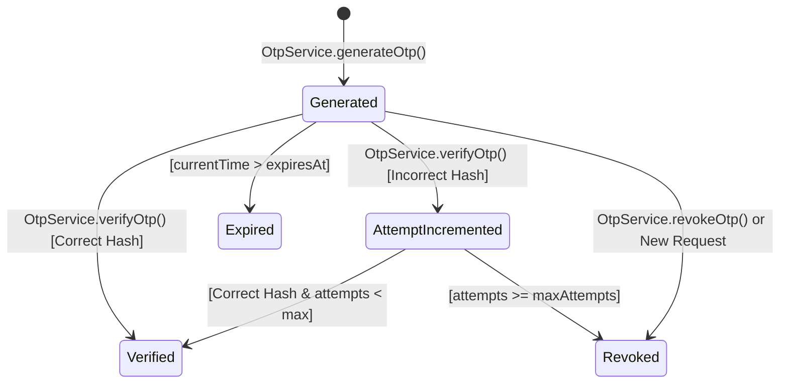

# OTP Infrastructure Architecture

The **OTP Infrastructure** in CampusFlow ERP is a standalone, completely decoupled service built to serve authentication, verification, and transactional confirmation requirements across all system modules.

---

## 1. Supported Decoupled Purposes

OTP generation is NOT hardcoded to Auth login or password reset. It supports 7 explicit business purposes:

1. `LOGIN`: Two-factor login verification.
2. `PASSWORD_RESET`: Forgotten password identity confirmation.
3. `EMAIL_VERIFY`: Primary/secondary email address verification.
4. `PHONE_VERIFY`: Mobile phone ownership verification.
5. `MFA`: Multi-Factor Authentication step.
6. `PAYMENT`: Sensitive fee/payment authorization.
7. `ADMISSION`: Online admission form verification.

---

## 2. OTP Lifecycle State Machine

---

## 3. Security Rules & Controls

- **Raw Storage Prohibition**: The database stores `otpHash` (`SHA-256`), NEVER raw numbers.
- **Max Attempt Lockout**: Standard `maxAttempts = 5`. Upon 5 incorrect attempts, token is automatically revoked.
- **Resend Cooldown**: Default `60s` cooldown between OTP generation requests for the same recipient & purpose. Prevents SMS gateway exhaustion.
- **Token Invalidation**: Successfully verifying an OTP marks it `isUsed: true` and revokes any remaining active tokens for that identifier & purpose.
