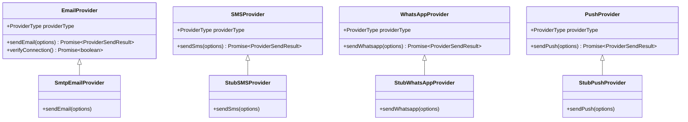

# Provider Abstraction Architecture

To shield CampusFlow ERP business logic from external vendor lock-in, all messaging transports are encapsulated behind unified abstract interfaces.

---

## 1. Provider Class Diagram



---

## 2. Standardized Provider Output (`ProviderSendResult`)

All providers return a consistent result format:

```typescript
export interface ProviderSendResult {
  success: boolean;
  messageId?: string;
  provider: ProviderType;
  channel: CommunicationChannel;
  latencyMs: number;
  errorCode?: string;
  errorMessage?: string;
  rawResponse?: any;
}
```

---

## 3. Provider Factory (`ProviderFactory`)

`ProviderFactory` acts as a dynamic factory, returning the appropriate active provider based on system/organization settings. Adding a new provider (e.g. AWS SES, Resend, Twilio, Meta WhatsApp) requires creating a new class implementing the respective interface and registering it in `ProviderFactory` without modifying any business services or controllers.
