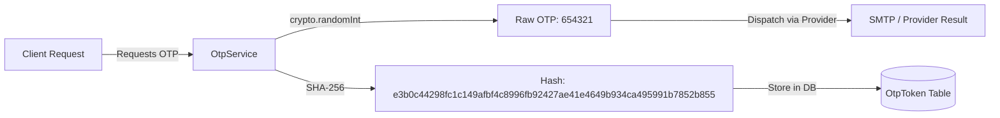

# Communication Security & Threat Model

The Communication Infrastructure implements strict enterprise security measures to protect sensitive operational credentials, user contact information, authentication OTPs, and password reset workflows.

---

## 1. Threat Model & Mitigation Strategy

| Threat Vector | Risk Level | Mitigation Mechanism |
| :--- | :--- | :--- |
| **Raw OTP Exposure in Database** | Critical | **Zero-Raw Storage**. Raw OTPs generated via `crypto.randomInt` are hashed with SHA-256 (`crypto.createHash('sha256')`). Only the hexadecimal hash is persisted in `OtpToken`. |
| **OTP Brute-Force Attacks** | High | **Attempt Lockout**. `maxAttempts` counter (default: 5). Once exceeded, token is immediately revoked (`isRevoked: true`). |
| **OTP Request Flooding** | High | **Resend Cooldown Enforcement**. `resendAvailableAt` timestamp (default: 60s cooldown). Prevents spam generation for the same purpose & recipient. |
| **Credential Leakage in Logs** | Critical | **Log Sanitization**. Pino logger suppresses authorization headers, raw OTPs, SMTP passwords, and external API keys. |
| **Unauthorized Template Override** | Medium | **RBAC Guarding**. Template modification endpoints (`POST/PATCH /v1/communication/templates`) require `SUPER_ADMIN` or `ORG_ADMIN` roles. |
| **Sensitive Payload Exposure in Audit**| Medium | Domain events dispatched for auditing do not contain raw passwords, SMTP socket handshake details, or full rendered email HTML bodies. |

---

## 2. OTP Hashing Architecture

---

## 3. Mandatory Channel Security Overrides

User notification preferences allow users to opt-out of promotional or non-critical notification categories. However, for security-critical operations (`AUTHENTICATION` category—such as OTP logins, password resets, and MFA prompts), **security rules override user preference opt-outs** to prevent account takeover or lockouts.
