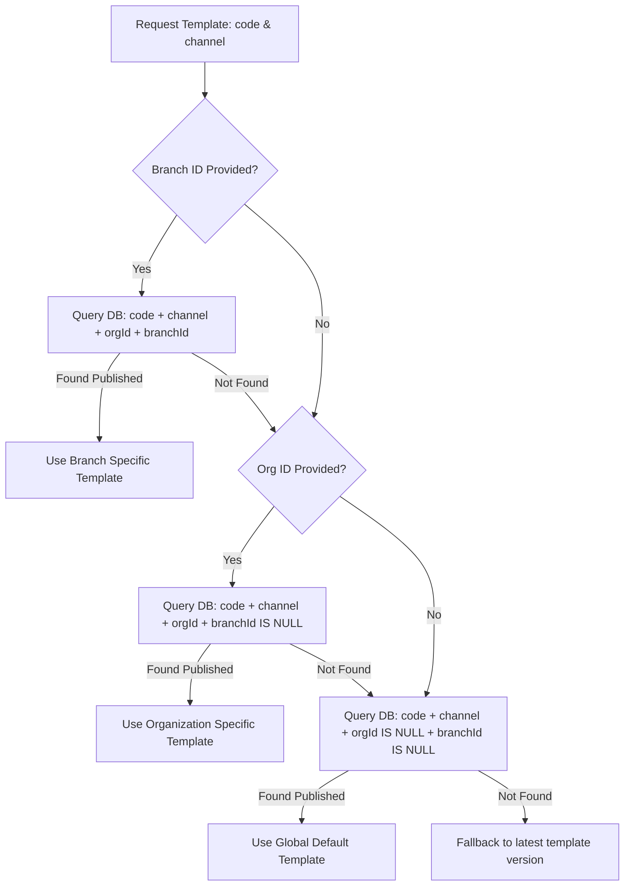

# Template Engine & Multi-Tenant Override Architecture

CampusFlow ERP incorporates a multi-channel template engine supporting dynamic variable substitution, versioning, status governance (`DRAFT`, `PUBLISHED`, `ARCHIVED`), and hierarchical multi-tenant overrides.

---

## 1. Hierarchical Template Resolution Sequence

When a message dispatch occurs, `TemplateService.resolveTemplate(code, channel, context)` resolves templates according to the following order:

---

## 2. Dynamic Variable Syntax & Rendering Engine

Templates use mustache-style double curly brace syntax: `{{variableName}}` or nested path syntax `{{user.name}}`.

`HandlebarsTemplateRenderer`:
- Replaces variables safely without throwing runtime crashes.
- Returns missing variables in `RenderResult.missingVariables` for validation.
- Extracts declared variables automatically upon template creation/update if none are specified.

### Supported Common Standard Placeholders:
- `{{userName}}`: Target recipient full name
- `{{organizationName}}`: Institutional group name
- `{{branchName}}`: Specific campus name
- `{{otp}}`: Generated one-time password string
- `{{minutes}}`: Expiry duration in minutes
- `{{resetLink}}`: Secure password reset URL
- `{{amount}}`: Monetary amount
- `{{currency}}`: Active branch currency symbol (e.g. `INR`, `USD`)
