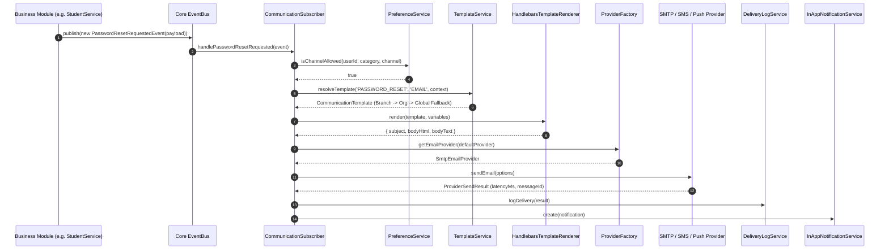
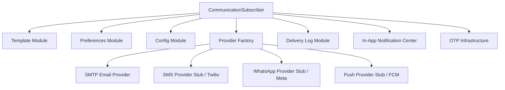

# Enterprise Communication Infrastructure Architecture

The **Communication Infrastructure** in CampusFlow ERP provides a centralized, reusable, highly scalable, multi-channel messaging platform (Email, SMS, WhatsApp, Push, In-App Notifications, and OTP).

Following **Anti-Gravity Clean Architecture**, business modules (Auth, Admissions, Fees, HR, Academic, Examination, etc.) remain **completely communication-agnostic**. They do NOT import `EmailService`, `SMSService`, or provider implementations. Business modules only publish `DomainEvents` over the core `EventBus`. The Communication Infrastructure subscribes to these domain events and handles template resolution, preference filtering, provider dispatch, in-app notification storage, delivery logging, and operational analytics.

---

## 1. High-Level Architecture & Sequence Diagram

---

## 2. Core Architectural Principles

1. **Zero Business Coupling**: Business services call only `eventBus.publish(new MyDomainEvent(...))`. They are unaware of email addresses, SMS provider credentials, or template engines.
2. **Multi-Tenant Override Hierarchy**: Templates and configurations resolve dynamically using the fallback chain:
   $$\text{Branch Override} \longrightarrow \text{Organization Override} \longrightarrow \text{Global Default}$$
3. **Transport Independence**: Current transport operates synchronously over NestJS `EventBus`. Migrating to Redis, BullMQ, Kafka, or AWS SQS requires changing only the `EventBus` adapter without altering business code or communication service logic.
4. **Decoupled Delivery & Audit**: DeliveryLog records operational network/provider state (`latencyMs`, `bounced`, `failed`), whereas AuditLog records business user actions.
5. **Decoupled OTP Infrastructure**: OTP generation and verification are independent of Auth and reusable across `LOGIN`, `PASSWORD_RESET`, `EMAIL_VERIFY`, `PHONE_VERIFY`, `MFA`, `PAYMENT`, and `ADMISSION`. Raw OTPs are NEVER stored—only SHA-256 hashes are persisted.

---

## 3. Bounded Context Bounded Map

---

## 4. Operational Best Practices & Guidelines

- **Always Use Domain Events**: Do not expose `CommunicationService.sendEmail(...)` to business controllers.
- **Mask Sensitive Logs**: Never log raw OTPs, SMTP passwords, or reset tokens.
- **Idempotent Deliveries**: Pass unique correlation IDs to avoid duplicate message dispatches.
- **Fail-Safe Subscriber Execution**: Failures in sending email must be logged to `DeliveryLog` and never crash upstream business database transactions.
