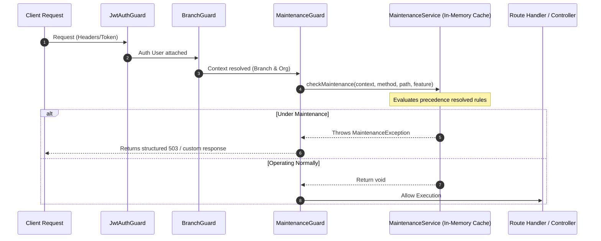

# Enterprise Maintenance Management System

The Enterprise Maintenance Management System allows administrators to restrict access to specific parts of CampusFlow ERP for maintenance activities while keeping other parts of the application operational.

---

## 🚀 Architecture Overview

Interception is executed globally at the NestJS Guard layer (`MaintenanceGuard`) which runs after authentication (`JwtAuthGuard`) and context initialization (`BranchGuard`). This sequence ensures that all context metadata (user role, organization, branch) is fully populated before rule evaluation occurs.

### Interception Sequence



---

## 🛠️ Data Structure (`MaintenanceRule`)

Rules are stored in the `MaintenanceRule` table.

| Field Name | Type | Description |
| :--- | :--- | :--- |
| `id` | `String (UUID v7)` | Primary Key. |
| `scopeType` | `MaintenanceScopeType` | `GLOBAL`, `ORGANIZATION`, `BRANCH`, `MODULE`, `FEATURE` |
| `scopeId` | `String?` | Target identifier (null for GLOBAL; organizationId, branchId, module name, or feature name) |
| `isActive` | `Boolean` | Toggles the rule. Defaults to `true`. |
| `allowLogin` | `Boolean` | Allow logins during maintenance. Defaults to `false`. |
| `allowReadApis` | `Boolean` | Allow GET, HEAD, OPTIONS requests. Defaults to `true`. |
| `allowWriteApis` | `Boolean` | Allow POST, PUT, PATCH, DELETE requests. Defaults to `false`. |
| `customStatus` | `Int` | HTTP response status code (e.g. 503, 423). |
| `customPage` | `String?` | Public URL/path for maintenance details. |
| `bypassRoles` | `Json?` | JSON array of role names allowed to bypass this rule (e.g., `["DEVOPS"]`). |
| `startAt` / `endAt` | `DateTime?` | Scheduled maintenance window limits. |
| `timezone` | `String` | Reference timezone for evaluating recurring windows. |
| `isRecurring` | `Boolean` | Enables weekly recurrence. |
| `recurrenceDayOfWeek` | `Int?` | 0 (Sunday) to 6 (Saturday). |
| `recurrenceStartTime` | `String?` | "HH:MM" start time. |
| `recurrenceEndTime` | `String?` | "HH:MM" end time. |

---

## 🔄 Precedence Resolution (Priority Order)

When a request is evaluated, all active rules are filtered against the current execution details. The system resolves maintenance rules in the following order:

$$\text{GLOBAL} \rightarrow \text{ORGANIZATION} \rightarrow \text{BRANCH} \rightarrow \text{MODULE} \rightarrow \text{FEATURE}$$

The **highest matching rule in the hierarchy takes total precedence**. For example, if a global rule is active, all lower-level rules are overridden.

---

## 🛡️ Role Exceptions

* **SUPER_ADMIN**: Always bypasses maintenance checks, ensuring administrators can never be locked out.
* **Configurable Roles**: Each rule can define a `bypassRoles` string array (e.g., `["SYSTEM_ADMIN", "DEVOPS"]`) in the database, allowing specific engineering roles to bypass maintenance.

---

## 📅 Scheduled & Recurring Windows

* **Immediate Activation**: Set `isActive = true` with no start/end dates.
* **Scheduled Activation**: Configure `startAt` and/or `endAt` timestamps. The rule dynamically activates when the current time enters this range and automatically deactivates (expires) once it passes `endAt`.
* **Timezone-Aware Weekly Recurrence**: Setting `isRecurring = true` evaluates local time within the specified `timezone` (e.g., `Asia/Kolkata`). The rule will automatically apply during the specified `recurrenceDayOfWeek` and time boundaries (e.g., every Sunday from 02:00 to 04:00 AM).

---

## ⚙️ Developer Guide

### 1. Registering Features under Maintenance
To lock down specific features (e.g., admission approval), decorate the endpoint handler or controller with `@MaintenanceFeature('feature_name')`:

```typescript
import { MaintenanceFeature } from '@/common/decorators/maintenance.decorator';

@Post('approve')
@MaintenanceFeature('admission_approval')
async approveAdmission() {
  // logic
}
```

Then create a maintenance rule in the database with:
* `scopeType = FEATURE`
* `scopeId = "admission_approval"`

### 2. Adding Future Modules
The `MaintenanceService` infers module names from the request URL path. To map a new path prefix to a custom module:
1. Open `maintenance.service.ts`.
2. Update the `inferModuleFromPath` method mapping.

---

## 📊 API Reference

### 1. Check Active Status
`GET /v1/maintenance-rules/active/status` (Public)
* Returns the active maintenance details applying to the request based on request headers (`x-branch-id`).

### 2. Manage Rules
CRUD endpoints restricted to `SUPER_ADMIN`:
* `POST /v1/maintenance-rules`: Create rule.
* `GET /v1/maintenance-rules`: List all rules.
* `GET /v1/maintenance-rules/:id`: Fetch specific rule details.
* `PATCH /v1/maintenance-rules/:id`: Update rule.
* `DELETE /v1/maintenance-rules/:id`: Remove rule.
