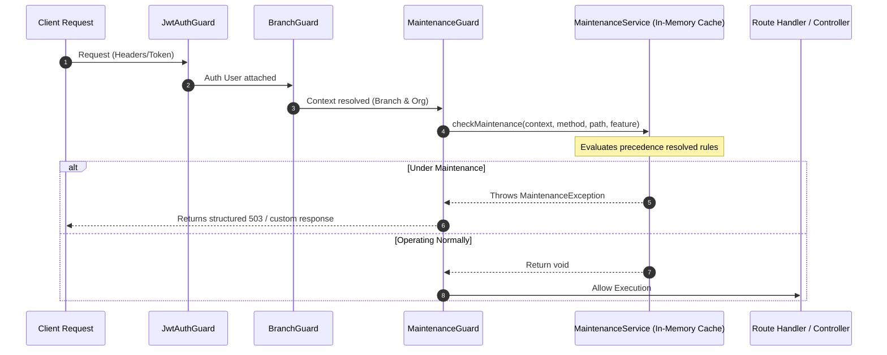

# Enterprise Maintenance Management System

The Enterprise Maintenance Management System allows administrators to restrict access to specific parts of CampusFlow ERP for maintenance activities while keeping other parts of the application operational.

---

## 🚀 Architecture Overview

Interception is executed globally at the NestJS Guard layer (`MaintenanceGuard`) which runs after authentication (`JwtAuthGuard`) and context initialization (`BranchGuard`). This sequence ensures that all context metadata (user role, organization, branch) is fully populated before rule evaluation occurs.

### Interception Sequence



---

## 🛠️ Data Structure (`MaintenanceRule`)

Rules are stored in the `MaintenanceRule` table.

| Field Name | Type | Description |
| :--- | :--- | :--- |
| `id` | `String (UUID v7)` | Primary Key. |
| `scopeType` | `MaintenanceScopeType` | `GLOBAL`, `ORGANIZATION`, `BRANCH`, `MODULE`, `FEATURE` |
| `scopeId` | `String?` | Target identifier (null for GLOBAL; organizationId, branchId, module name, or feature name) |
| `isActive` | `Boolean` | Toggles the rule. Defaults to `true`. |
| `allowLogin` | `Boolean` | Allow logins during maintenance. Defaults to `false`. |
| `allowReadApis` | `Boolean` | Allow GET, HEAD, OPTIONS requests. Defaults to `true`. |
| `allowWriteApis` | `Boolean` | Allow POST, PUT, PATCH, DELETE requests. Defaults to `false`. |
| `customStatus` | `Int` | HTTP response status code (e.g. 503, 423). |
| `customPage` | `String?` | Public URL/path for maintenance details. |
| `bypassRoles` | `Json?` | JSON array of role names allowed to bypass this rule (e.g., `["DEVOPS"]`). |
| `startAt` / `endAt` | `DateTime?` | Scheduled maintenance window limits. |
| `timezone` | `String` | Reference timezone for evaluating recurring windows. |
| `isRecurring` | `Boolean` | Enables weekly recurrence. |
| `recurrenceDayOfWeek` | `Int?` | 0 (Sunday) to 6 (Saturday). |
| `recurrenceStartTime` | `String?` | "HH:MM" start time. |
| `recurrenceEndTime` | `String?` | "HH:MM" end time. |
| `createdBy` / `updatedBy` | `String?` | User id. |
| `createdAt` / `updatedAt` | `DateTime` | |

### Presentation fields

These twelve are **persisted columns and are returned on every read**, exactly
like the fields above. They were previously absent from this table while
appearing in the create and update bodies, which left a reader unable to tell
whether they were stored or discarded. They are stored.

| Field Name | Type | Description |
| :--- | :--- | :--- |
| `title` | `String?` | Heading for the notice. |
| `shortMessage` | `String?` | One-line summary. |
| `description` | `String?` | Longer explanation. |
| `reason` | `String?` | Why the window exists. |
| `estimatedCompletion` | `DateTime?` | **A timestamp, not free text.** Serialized ISO 8601. |
| `maintenanceWindow` | `String?` | Human-readable window, e.g. `"02:00–04:00 IST"`. Free text; the machine-readable window is `startAt`/`endAt`. |
| `supportContact` | `String?` | Contact shown on the notice. |
| `bannerColor` | `String?` | Free-form colour, e.g. `"#f59e0b"`. |
| `severity` | `MaintenanceSeverity?` | **`INFO`, `WARNING` or `CRITICAL`.** Defaults to `INFO`. |
| `maintenanceIcon` | `String?` | Icon identifier. |
| `announcementLink` | `String?` | Link to an announcement. |
| `externalStatusPageUrl` | `String?` | Link to an external status page. |

### Field notes

- **`severity` is a database enum**, not free text: `INFO | WARNING | CRITICAL`.
  A client can safely offer these three as a select, and can colour a notice by
  them.
- **`estimatedCompletion` is a `DateTime`**, serialized as an ISO 8601 string —
  not free text. `maintenanceWindow` is the free-text field.
- **`startAt` / `endAt` are ISO 8601** on the wire, like every other timestamp
  in the platform.
- **`bypassRoles` is a JSON array of strings.** The array itself is
  unconstrained — the guard compares the caller's role name against its
  entries, so any string is accepted and only a name matching a real role has
  an effect. The platform's roles are `SUPER_ADMIN`, `ORG_ADMIN`,
  `BRANCH_ADMIN`, `STAFF`, `STUDENT`, `PARENT`; values outside that set, such as
  the `DEVOPS` seen in older samples, are stored and never match.
- **`customStatus` defaults to `503`** and is validated only as a number — no
  range is enforced, so a value outside 100–599 is accepted by the API.
- **`scopeId` for `MODULE` and `FEATURE` is not enumerated.** No endpoint lists
  the legal module or feature names; the guard string-matches whatever is
  stored, so a typo produces a rule that silently never fires.

---

## 🔄 Precedence Resolution (Priority Order)

When a request is evaluated, all active rules are filtered against the current execution details. The system resolves maintenance rules in the following order:

$$\text{GLOBAL} \rightarrow \text{ORGANIZATION} \rightarrow \text{BRANCH} \rightarrow \text{MODULE} \rightarrow \text{FEATURE}$$

The **highest matching rule in the hierarchy takes total precedence**. For example, if a global rule is active, all lower-level rules are overridden.

---

## 🛡️ Role Exceptions

* **SUPER_ADMIN**: Always bypasses maintenance checks, ensuring administrators can never be locked out.
* **Configurable Roles**: Each rule can define a `bypassRoles` string array (e.g., `["SYSTEM_ADMIN", "DEVOPS"]`) in the database, allowing specific engineering roles to bypass maintenance.

---

## 📅 Scheduled & Recurring Windows

* **Immediate Activation**: Set `isActive = true` with no start/end dates.
* **Scheduled Activation**: Configure `startAt` and/or `endAt` timestamps. The rule dynamically activates when the current time enters this range and automatically deactivates (expires) once it passes `endAt`.
* **Timezone-Aware Weekly Recurrence**: Setting `isRecurring = true` evaluates local time within the specified `timezone` (e.g., `Asia/Kolkata`). The rule will automatically apply during the specified `recurrenceDayOfWeek` and time boundaries (e.g., every Sunday from 02:00 to 04:00 AM).

---

## ⚙️ Developer Guide

### 1. Registering Features under Maintenance
To lock down specific features (e.g., admission approval), decorate the endpoint handler or controller with `@MaintenanceFeature('feature_name')`:

```typescript
import { MaintenanceFeature } from '@/common/decorators/maintenance.decorator';

@Post('approve')
@MaintenanceFeature('admission_approval')
async approveAdmission() {
  // logic
}
```

Then create a maintenance rule in the database with:
* `scopeType = FEATURE`
* `scopeId = "admission_approval"`

### 2. Adding Future Modules
The `MaintenanceService` infers module names from the request URL path. To map a new path prefix to a custom module:
1. Open `maintenance.service.ts`.
2. Update the `inferModuleFromPath` method mapping.

---

## 📊 API Reference

### 1. Check Active Status

`GET /v1/maintenance-rules/active/status` (Public)

Returns the maintenance state applying to *this* request, resolved from its
context headers (`x-branch-id`, `x-organization-id`) and the caller's role.

**The response has two shapes.** When no rule matches, `maintenanceEnabled` is
the only field present — there is no rule to describe:

```json
{
  "success": true,
  "message": "System is operating normally",
  "data": { "maintenanceEnabled": false },
  "meta": {},
  "error": null,
  "requestId": "019fc2a1-0d7c-76cd-86ec-cbdf1628a566",
  "timestamp": "2026-08-05T09:12:44.310Z"
}
```

When a rule matches, the resolved rule is flattened into the payload:

```json
{
  "success": true,
  "message": "Active maintenance rule resolved",
  "data": {
    "maintenanceEnabled": true,
    "maintenanceScope": "BRANCH",
    "scopeType": "BRANCH",
    "scopeId": "018f3a5b-7c9d-7e8f-9a0b-1c2d3e4f5a6c",
    "title": "System Maintenance",
    "message": "We will be back shortly.",
    "description": "",
    "reason": "Database migration",
    "estimatedCompletion": "2026-08-05T04:00:00.000Z",
    "supportContact": "support@northfield.edu",
    "maintenanceWindow": "02:00–04:00 IST",
    "readOnly": true,
    "allowedOperations": ["GET", "HEAD", "OPTIONS"]
  },
  "meta": {},
  "error": null,
  "requestId": "019fc2a1-0d7c-76cd-86ec-cbdf1628a566",
  "timestamp": "2026-08-05T09:12:44.310Z"
}
```

Notes on the matched shape:

- `maintenanceScope` and `scopeType` are the **same value**, sent under two
  names. `scopeType` is the canonical one.
- `message` here is the rule's `shortMessage`, not the envelope's `message`.
- `title`, `message`, `description`, `reason`, `supportContact` and
  `maintenanceWindow` fall back to `""` or a default string when the rule left
  them null — they are never null in this payload.
- `readOnly` is `!allowWriteApis`.
- `allowedOperations` is the full method list when writes are allowed, and
  `["GET", "HEAD", "OPTIONS"]` when they are not.
- The rule's `id`, `severity`, `bannerColor`, `maintenanceIcon`,
  `announcementLink` and `externalStatusPageUrl` are **not** included in this
  payload. Read the rule through the CRUD endpoints to get them.

### 2. Manage Rules
CRUD endpoints restricted to `SUPER_ADMIN`:
* `POST /v1/maintenance-rules`: Create rule.
* `GET /v1/maintenance-rules`: List all rules.
* `GET /v1/maintenance-rules/:id`: Fetch specific rule details.
* `PATCH /v1/maintenance-rules/:id`: Update rule. **Accepts a partial body.**
* `DELETE /v1/maintenance-rules/:id`: Remove rule.

Notes:

- `GET /v1/maintenance-rules` returns **every** rule, active and inactive, as a
  plain array under `data`. It documents no `page`, `limit`, `search` or filter
  parameters — a client that needs them narrows the list itself.
- `PATCH` accepts a subset: `UpdateMaintenanceRuleDto` extends
  `PartialType(CreateMaintenanceRuleDto)`, so omitted fields are left alone.
- `DELETE` is a **hard delete** — the row is removed, not flagged. Its payload
  is `data: null`.
- Full request and response schemas, including examples for every field, are in
  Swagger at `/docs`.
